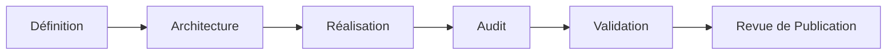
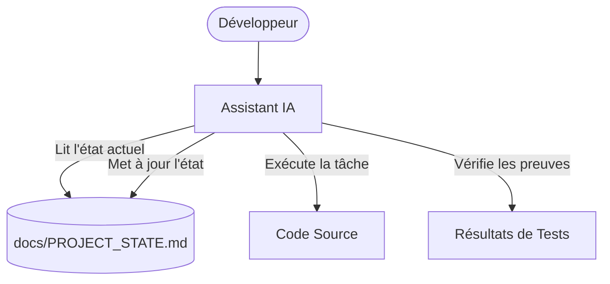

# CalmTechnology-DevToolkit

> **Version 0.1.0 — Foundation**  
> Cadre méthodologique pour un développement logiciel assisté par IA rigoureux, traçable et fondé sur les preuves.  
> Organisation : [calmtechnology-ch](https://github.com/calmtechnology-ch) | Licence : MIT

---

## 1. Pourquoi CalmTechnology-DevToolkit existe

Les assistants de programmation par IA génèrent du code en quelques secondes. Cependant, le développement non cadré (« vibe-coding ») engendre fréquemment des régressions insidieuses, une architecture floue, des exigences oubliées et du code fragile. Cette vulnérabilité est particulièrement critique sur les systèmes embarqués contraints (ESP32, ESP32-S3, M5Stack CoreS3), les interfaces audio temps réel et les applications logicielles complexes.

**CalmTechnology-DevToolkit** apporte méthode, rigueur et prévisibilité au développement assisté par IA. L'assistant n'est plus un simple générateur de lignes de code, mais un copilote technique intégré dans un cycle d'ingénierie complet :



---

## 2. Public cible

- **Ingénieurs en systèmes embarqués** : Développeurs ESP32, ESP32-S3, M5Stack CoreS3 avec FreeRTOS, PlatformIO, LVGL 9 et M5GFX.
- **Développeurs d'applications** : Concepteurs d'applications Web, Electron et Python intégrant ou non des modèles d'IA locaux ou distants.
- **Développeurs assistés par IA** : Professionnels souhaitant encadrer leur assistant par une méthode structurée et reproductible.
- **Chefs de projets et architectes** : Équipes nécessitant une traçabilité explicite entre exigences, décisions d'architecture (ADR), code source et validations matérielles.

---

## 3. Ce que le toolkit propose (et ce qu'il exclut)

### Ce qui est disponible dans la version 0.1.0 (Foundation)
- **8 Compétences spécialisées (`skills/`)** : Rôles d'ingénierie documentés avec en-têtes YAML et 12 sections normées.
- **7 Workflows opérationnels (`workflows/`)** : Processus directeurs pour nouveaux projets, reprise d'existant, nouvelles fonctionnalités, audits de code, releases correctives, campagnes de régression et publications.
- **12 Modèles documentaires (`templates/`)** : Fiches prêtes à l'emploi pour exigences, architecture, décisions d'architecture (ADR), état du projet, plans et résultats de tests.
- **6 Profils techniques (`profiles/`)** : Fiches de contraintes matérielles et logicielles pour ESP32, CoreS3, applications vocales, Web, Electron et Python.
- **8 Prompts réutilisables (`prompts/`)** : Prompts structurés prêts à copier pour les assistants IA (Antigravity, Claude, ChatGPT, etc.).
- **Exemple pédagogique complet (`examples/CoreS3-RuleBot/`)** : Scénario d'ingénierie fondé sur le projet réel open-source CoreS3-RuleBot.
- **Grille de contrôle Quality Gates (`docs/QUALITY_GATES.md`)** : 6 points de contrôle formels (QG-01 à QG-06).

### Périmètre strict de la version 0.1.0
- **Aucun logiciel exécutable embarqué dans le toolkit** : Pas d'interface Electron, pas de serveur Web local, pas de démon Python dans le toolkit.
- **Aucune dépendance externe** : Pas de clés API requises, pas d'abonnements tiers obligatoires.
- **Aucune base vectorielle opaque** : Toutes les connaissances et l'état du projet résident dans des fichiers Markdown versionnés dans Git.

---

## 4. Démarrage rapide (en 5 minutes)

### Étape 1 : Rendre le toolkit accessible
Placez le dossier `CalmTechnology-DevToolkit` dans votre espace de travail ou indiquez son chemin à votre assistant IA :
```text
mon-projet/
├── docs/                      # Documentation de votre projet (créée via les modèles)
└── CalmTechnology-DevToolkit/ # Boîte à outils de référence
```

### Étape 2 : Initialiser la documentation de votre projet
Copiez les modèles du dossier `CalmTechnology-DevToolkit/templates/` vers le dossier `docs/` de votre projet :
- `PROJECT.md`
- `REQUIREMENTS.md`
- `ARCHITECTURE.md`
- `DECISIONS.md`
- `PROJECT_STATE.md`
- `TEST_PLAN.md`
- `TEST_RESULTS.md`
- `KNOWN_ISSUES.md`

### Étape 3 : Guider votre assistant IA
Transmettez le fichier `AGENTS.md` à votre assistant et formulez votre demande :
```text
Merci de lire CalmTechnology-DevToolkit/AGENTS.md.
Nous débutons un projet selon le workflow CalmTechnology-DevToolkit/workflows/new-project.md.
Active la compétence CalmTechnology-DevToolkit/skills/project-definition/SKILL.md.
```

---

## 5. Principe fondamental : la mémoire documentaire

Le document pivot de tout projet est `PROJECT_STATE.md`. Il protège le projet des limites de contexte des conversations IA :



Lorsqu'une nouvelle session de discussion s'ouvre, l'assistant consulte `PROJECT_STATE.md` pour connaître immédiatement :
1. La version et le commit réels.
2. Les fonctionnalités validées et strictement protégées contre toute régression.
3. Les anomalies ouvertes et leurs priorités.
4. La prochaine action recommandée.

---

## 6. Structure du dépôt

```text
CalmTechnology-DevToolkit/
├── README.md               # Présentation du projet en anglais
├── README.fr.md            # Présentation du projet en français
├── LICENSE                 # Licence MIT
├── VERSION                 # Version du toolkit (0.1.0)
├── CHANGELOG.md            # Journal des modifications
├── AGENTS.md               # Règles d'engagement obligatoires pour l'IA
├── CONTRIBUTING.md         # Guide de contribution
├── skills/                 # 8 compétences d'ingénierie
├── workflows/              # 7 workflows méthodologiques
├── templates/              # 12 modèles de documents
├── profiles/               # 6 profils techniques de contraintes
├── prompts/                # 8 prompts prêts à l'emploi
├── examples/               # Exemple pédagogique CoreS3-RuleBot
└── docs/                   # Documentation méthodologique complète
```

---

## 7. Exemple pédagogique : CoreS3-RuleBot

Consultez `examples/CoreS3-RuleBot/` pour étudier un cas réel et complet :
- Respect des contraintes matérielles ESP32-S3 et M5Stack CoreS3 (écran ILI9342 en paysage natif à `setRotation(0)`).
- Normalisation et appariement déterministe de texte sans dépendre d'un LLM distant.
- Matrice de tests séparant rigoureusement compilation hôte, simulation PC et validation sur matériel réel.
- Scénario d'audit, de correction ciblée et de revue de publication Go/No-Go.

---

## 8. Index de la documentation

- [Guide de démarrage (FR)](docs/GETTING_STARTED.fr.md) / [Getting Started Guide (EN)](docs/GETTING_STARTED.md)
- [Guide utilisateur (FR)](docs/USER_GUIDE.fr.md) / [User Guide (EN)](docs/USER_GUIDE.md)
- [Méthode de développement](docs/DEVELOPMENT_METHOD.md)
- [Cycle de vie du projet](docs/PROJECT_LIFECYCLE.md)
- [Format standard des compétences](docs/SKILL_FORMAT.md)
- [Guide d'intégration Antigravity](docs/ANTIGRAVITY_INTEGRATION.md)
- [Spécification des Quality Gates](docs/QUALITY_GATES.md)
- [Glossaire](docs/GLOSSARY.md)
- [Rapport de validation v0.1.0](docs/VALIDATION_REPORT_v0.1.0.md)
