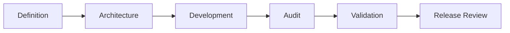

# CalmTechnology-DevToolkit

> **Version 0.1.0 — Foundation**  
> Methodological framework for disciplined, evidence-based, AI-assisted software engineering.  
> Organization: [calmtechnology-ch](https://github.com/calmtechnology-ch) | License: MIT

---

## 1. Why CalmTechnology-DevToolkit Exists

AI code assistants have transformed software development by generating code in seconds. However, unguided "vibe-coding" often leads to subtle regressions, undocumented architecture, lost requirements, and brittle systems. This fragility is especially acute in resource-constrained embedded systems (such as ESP32, ESP32-S3, M5Stack CoreS3), real-time audio pipelines, and desktop/web applications.

**CalmTechnology-DevToolkit** restores rigor, repeatability, and calm predictability to AI-assisted development. It ensures that AI assistants do not merely output loose code snippets, but participate in a structured engineering lifecycle:



---

## 2. Target Audience

- **Embedded Systems Engineers**: Working on ESP32, ESP32-S3, M5Stack CoreS3 with FreeRTOS, PlatformIO, LVGL 9, and M5GFX.
- **Full-Stack & Application Developers**: Developing Web, Electron, and Python applications with local or remote AI models.
- **AI-Augmented Developers**: Engineers who want an AI assistant to act as a disciplined co-pilot rather than an erratic code generator.
- **Technical Leads**: Teams seeking consistent traceability between user requirements, architectural decisions, code changes, and hardware validation results.

---

## 3. What the Toolkit Does (and What It Does Not Do)

### What it Provides in v0.1.0 (Foundation)
- **8 Specialized Skills (`skills/`)**: Modular engineering capabilities formatted with standard YAML headers and 12 structured sections.
- **7 Prescriptive Workflows (`workflows/`)**: Step-by-step lifecycles for new projects, existing project imports, feature additions, code audits, bugfixes, regression runs, and releases.
- **12 Production Templates (`templates/`)**: Canonical markdown templates for requirements, architecture, ADRs, project state, test matrices, and audit reports.
- **6 Technical Profiles (`profiles/`)**: Hardware and software constraints for ESP32, M5Stack CoreS3, Voice applications, Web apps, Electron, and Python.
- **8 Reusable Prompts (`prompts/`)**: Ready-to-use prompts for AI assistants (Antigravity, Claude, ChatGPT, etc.).
- **Complete Educational Example (`examples/CoreS3-RuleBot/`)**: A documented scenario based on the real open-source M5Stack CoreS3 deterministic rule bot.
- **Quality Gates Framework (`docs/QUALITY_GATES.md`)**: 6 objective checkpoints (QG-01 to QG-06) to prevent untested deployments.

### Strict Boundaries for v0.1.0
- **No executable runtime software**: No Electron GUI, no local web server, no Python daemon inside the toolkit.
- **No external API dependencies**: No mandatory subscription or cloud API connection.
- **No black-box vector stores**: Everything is recorded in human-readable, version-controlled Markdown.

---

## 4. Quick Start (5 Minutes)

### Step 1: Add the Toolkit to Your Workspace
Place `CalmTechnology-DevToolkit` inside your workspace or configure your AI assistant to read its directory:
```text
my-project/
├── docs/                      # Your project documentation (created via templates)
└── CalmTechnology-DevToolkit/ # Reference toolkit
```

### Step 2: Initialize Your Project Documentation
Copy the templates from `CalmTechnology-DevToolkit/templates/` into your project's `docs/` folder:
- `PROJECT.md`
- `REQUIREMENTS.md`
- `ARCHITECTURE.md`
- `DECISIONS.md`
- `PROJECT_STATE.md`
- `TEST_PLAN.md`
- `TEST_RESULTS.md`
- `KNOWN_ISSUES.md`

### Step 3: Run with Your AI Assistant
Provide your assistant with `AGENTS.md` and the initial prompt:
```text
Please read CalmTechnology-DevToolkit/AGENTS.md.
We are starting a new project following CalmTechnology-DevToolkit/workflows/new-project.md.
Activate the skill CalmTechnology-DevToolkit/skills/project-definition/SKILL.md.
```

---

## 5. Core Philosophy: The Living Project State

The single most critical document in any project is `PROJECT_STATE.md`. It isolates project truth from AI chat context limits:


Whenever a conversation resets, the assistant simply reads `PROJECT_STATE.md` to know:
1. Current version and commit.
2. What is validated and strictly protected from regression.
3. Open defects and active investigations.
4. The exact recommended next action.

---

## 6. Repository Layout

```text
CalmTechnology-DevToolkit/
├── README.md               # English project presentation
├── README.fr.md            # French project presentation
├── LICENSE                 # MIT License
├── VERSION                 # Current toolkit version (0.1.0)
├── CHANGELOG.md            # Release log
├── AGENTS.md               # Mandatory operational rules for AI assistants
├── CONTRIBUTING.md         # Contribution guidelines
├── skills/                 # 8 structured engineering skills
├── workflows/              # 7 operational engineering workflows
├── templates/              # 12 project state and report templates
├── profiles/               # 6 technical constraint profiles
├── prompts/                # 8 reusable prompts for AI assistants
├── examples/               # Educational CoreS3-RuleBot implementation
└── docs/                   # Methodological documentation and guides
```

---

## 7. Educational Example: CoreS3-RuleBot

Explore `examples/CoreS3-RuleBot/` for a complete reference implementation demonstrating:
- ESP32-S3 / M5Stack CoreS3 hardware constraints (ILI9342 display native landscape orientation at `setRotation(0)`).
- Deterministic text normalization and tokenization without external cloud LLMs.
- Strict test matrices differentiating host compilation, PC simulation, and hardware validation.
- Walkthrough of a real corrective cycle and release gate review.

---

## 8. Documentation Index

- [Getting Started Guide](docs/GETTING_STARTED.md) / [Guide de démarrage (FR)](docs/GETTING_STARTED.fr.md)
- [Complete User Guide](docs/USER_GUIDE.md) / [Guide utilisateur (FR)](docs/USER_GUIDE.fr.md)
- [Development Methodology](docs/DEVELOPMENT_METHOD.md)
- [Project Lifecycle](docs/PROJECT_LIFECYCLE.md)
- [Skill Format Standard](docs/SKILL_FORMAT.md)
- [Antigravity Integration Guide](docs/ANTIGRAVITY_INTEGRATION.md)
- [Quality Gates Specification](docs/QUALITY_GATES.md)
- [Glossary](docs/GLOSSARY.md)
- [v0.1.0 Validation Report](docs/VALIDATION_REPORT_v0.1.0.md)
