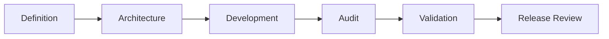
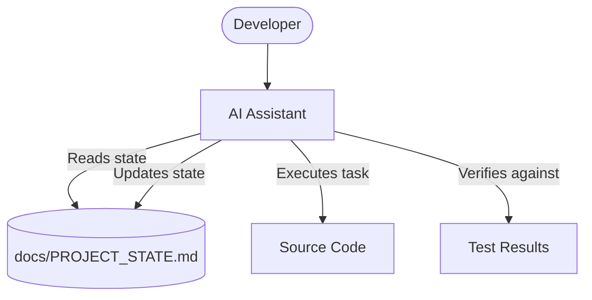

# CalmTechnology-DevToolkit

> **Version 0.1.0.1 — Corrective**  
> Methodological framework for disciplined, evidence-based, AI-assisted software engineering.  
> Organization: [calmtechnology-ch](https://github.com/calmtechnology-ch) | License: MIT

---

## 1. Why CalmTechnology-DevToolkit Exists

AI code assistants have transformed software development by generating code in seconds. However, unguided "vibe-coding" often leads to subtle regressions, undocumented architecture, lost requirements, and brittle systems. This fragility is especially acute in resource-constrained embedded systems (such as ESP32, ESP32-S3, M5Stack CoreS3), real-time audio pipelines, and desktop/web applications.

**CalmTechnology-DevToolkit** restores rigor, repeatability, and calm predictability to AI-assisted development. It ensures that AI assistants do not merely output loose code snippets, but participate in a structured engineering lifecycle:



---

## 2. Target Audience

- **Embedded Systems Engineers**: Working on ESP32, ESP32-S3, M5Stack CoreS3 with FreeRTOS, PlatformIO, LVGL 9, and M5GFX.
- **Full-Stack & Application Developers**: Developing Web, Electron, and Python applications with local or remote AI models.
- **AI-Augmented Developers**: Engineers who want an AI assistant to act as a disciplined co-pilot rather than an erratic code generator.
- **Technical Leads**: Teams seeking consistent traceability between user requirements, architectural decisions, code changes, and hardware validation results.

---

## 3. What the Toolkit Does (and What It Excludes)

### Preserved Foundation Components (v0.1.0 Baseline)
- **8 Specialized Skills (`skills/`)**: Modular engineering capabilities formatted with standard YAML headers and 12 structured sections.
- **7 Prescriptive Workflows (`workflows/`)**: Step-by-step lifecycles for new projects, existing project imports, feature additions, code audits, bugfixes, regression runs, and releases.
- **12 Production Templates (`templates/`)**: Canonical markdown templates for requirements, architecture, ADRs, project state, test matrices, and audit reports.
- **6 Technical Profiles (`profiles/`)**: Hardware and software constraints for ESP32, M5Stack CoreS3, Voice applications, Web apps, Electron, and Python.
- **8 Reusable Prompts (`prompts/`)**: Ready-to-use daily prompts with both quick-action and detailed technical formats.
- **Educational Example (`examples/CoreS3-RuleBot/`)**: A documented reference implementation based on the M5Stack CoreS3 deterministic rule bot.
- **Quality Gates Framework (`docs/QUALITY_GATES.md`)**: 6 objective checkpoints (`QG-01` to `QG-06`) with standardized statuses (`PASS`, `FAIL`, `BLOCKED`, `NOT_EVALUATED`, `NOT_APPLICABLE`).

### Improvements in v0.1.0.1 (Corrective)
- Canonical standard MIT License text in `LICENSE`.
- Evidence provenance categorization (`DIRECTLY_VERIFIED`, `USER_REPORTED`, `EXTERNAL_REPORTED`, `ILLUSTRATIVE`, `UNVERIFIED`).
- Unified test execution statuses (`NOT_RUN`, `PASS`, `FAIL`, `BLOCKED`, `NOT_APPLICABLE`).
- Separation of Quality Gate evaluations from executive Release Review decisions (`GO`, `CONDITIONAL_GO`, `NO_GO`, `INSUFFICIENT_EVIDENCE`).
- Simplified multi-project workspace setup and quick natural-language daily prompts.

### Strict Boundaries
- **No executable runtime software**: No Electron GUI, no local web server, no Python daemon inside the toolkit.
- **No external API dependencies**: No mandatory subscription or cloud API connection.
- **No black-box vector stores**: Everything is recorded in human-readable, version-controlled Markdown.

---

## 4. Quick Start: The 3 Everyday Situations

The toolkit is designed to be shared across multiple projects without duplicating repositories:

```text
Documents/
└── Antigravity-5.1/
    ├── CalmTechnology-DevToolkit/   # Shared methodology
    ├── MyProject/                   # Your project (with its own docs/ and src/)
    └── CoreS3-RuleBot/              # Another project
```

### Situation A — Starting a New Project
1. Open your project workspace and ensure `CalmTechnology-DevToolkit` is accessible.
2. In chat, send the quick prompt:
   ```text
   Utilise CalmTechnology-DevToolkit.
   Initialise la documentation de ce projet selon le workflow new-project.
   Ne commence pas à programmer.
   ```
3. Describe your project concept and requirements. The assistant sets up `docs/` and evaluates Gate `QG-01`.

### Situation B — Importing an Existing Codebase
1. Open the existing codebase directory in your editor.
2. In chat, send the quick prompt:
   ```text
   Utilise CalmTechnology-DevToolkit.
   Examine ce projet existant et initialise sa documentation à partir du code réel.
   Ne modifie aucun fichier source.
   ```
3. The assistant audits the codebase, reconstructs `docs/PROJECT_STATE.md`, and lists next actions without modifying code.

### Situation C — Resuming an Integrated Project
1. Open the project where `docs/PROJECT_STATE.md` already exists.
2. In chat, send the quick prompt:
   ```text
   Utilise CalmTechnology-DevToolkit.
   Lis PROJECT_STATE.md, vérifie l'état réel du projet et propose la prochaine étape.
   Ne modifie pas le code.
   ```
3. The assistant aligns on current project truth and recommends bounded next steps.

---

## 5. Core Philosophy: The Living Project State

The single most critical document in any project is `docs/PROJECT_STATE.md`. It isolates project truth from AI chat context limits:



Whenever a conversation resets, the assistant simply reads `PROJECT_STATE.md` to know:
1. Current version and commit.
2. What is validated and strictly protected from regression.
3. Open defects and active investigations.
4. The exact recommended next action.

---

## 6. Repository Layout

```text
CalmTechnology-DevToolkit/
├── README.md               # English project presentation
├── README.fr.md            # French project presentation
├── LICENSE                 # Canonical MIT License
├── VERSION                 # Current toolkit version (0.1.0.1)
├── CHANGELOG.md            # Release log
├── AGENTS.md               # Mandatory operational rules for AI assistants
├── CONTRIBUTING.md         # Contribution guidelines
├── skills/                 # 8 structured engineering skills
├── workflows/              # 7 operational engineering workflows
├── templates/              # 12 project state and report templates
├── profiles/               # 6 technical constraint profiles
├── prompts/                # 8 reusable prompts with quick daily and detailed formats
├── examples/               # Educational CoreS3-RuleBot case study
└── docs/                   # Methodological documentation and validation reports
```

---

## 7. Educational Example: CoreS3-RuleBot

Explore `examples/CoreS3-RuleBot/` for a complete reference case study demonstrating:
- ESP32-S3 / M5Stack CoreS3 hardware constraints (ILI9342 display native landscape orientation at `setRotation(0)`).
- Deterministic text normalization and tokenization without external cloud LLMs.
- Strict test matrices differentiating host simulation, hardware acceptance tests, and pedagogical scenarios.
- Walkthrough of a corrective bugfix cycle and formal release gate review.

---

## 8. Documentation Index

- [Getting Started Guide](docs/GETTING_STARTED.md) / [Guide de démarrage (FR)](docs/GETTING_STARTED.fr.md)
- [Complete User Guide](docs/USER_GUIDE.md) / [Guide utilisateur (FR)](docs/USER_GUIDE.fr.md)
- [Development Methodology](docs/DEVELOPMENT_METHOD.md)
- [Project Lifecycle](docs/PROJECT_LIFECYCLE.md)
- [Skill Format Standard](docs/SKILL_FORMAT.md)
- [Antigravity Integration Guide](docs/ANTIGRAVITY_INTEGRATION.md)
- [Quality Gates Specification](docs/QUALITY_GATES.md)
- [Glossary](docs/GLOSSARY.md)
- [v0.1.0.1 Corrective Validation Report](docs/VALIDATION_REPORT_v0.1.0.1.md)
- [v0.1.0 Foundation Validation Report](docs/VALIDATION_REPORT_v0.1.0.md)
