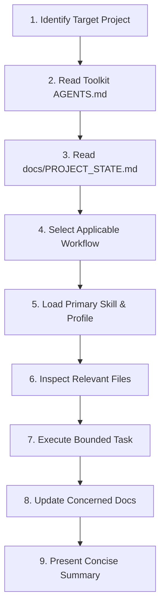

# Antigravity Integration Guide

This guide explains how to integrate and use the **CalmTechnology-DevToolkit** within Google Antigravity and compatible AI assistant environments.

---

## 1. Zero-Dependency Integration Model

The toolkit requires **zero executable runtime software, zero daemons, and zero proprietary plugins**. It operates entirely through structured Markdown documents, workflows, profiles, and skills.

The mandatory, baseline functioning of the toolkit relies exclusively on:
1. Reading Markdown files.
2. Accessing the target project directory.
3. Selecting an applicable workflow.
4. Reading the necessary skill and technical profile files.
5. Executing bounded engineering tasks authorized by the user.
6. Synchronizing living documentation in `docs/`.

---

## 2. Shared Multi-Project Workspace Organization

To avoid duplicating the toolkit inside every repository, maintain a single shared instance of `CalmTechnology-DevToolkit` alongside your target projects:

```text
Documents/
└── Antigravity-5.1/
    ├── CalmTechnology-DevToolkit/   # Shared toolkit (skills, workflows, templates)
    ├── CoreS3-RuleBot/              # Project A (own docs/ and src/)
    ├── VoiceKit/                    # Project B (own docs/ and src/)
    ├── VoiceJournal/                # Project C (own docs/ and src/)
    └── OtherProject/                # Project D (own docs/ and src/)
```

Each target project maintains its own isolated living documentation in `docs/`:

```text
CoreS3-RuleBot/
├── src/
├── include/
├── platformio.ini
└── docs/
    ├── PROJECT.md
    ├── REQUIREMENTS.md
    ├── ARCHITECTURE.md
    ├── DECISIONS.md
    ├── PROJECT_STATE.md
    ├── TEST_PLAN.md
    ├── TEST_RESULTS.md
    └── KNOWN_ISSUES.md
```

### Path Resolution Rules
- **No Git submodules, symlinks, or file duplication required**.
- Provide the relative or absolute path to the toolkit in your session prompt:
  - Relative (sibling folder): `../CalmTechnology-DevToolkit`
  - Absolute (Windows): `C:/Users/<Username>/Documents/Antigravity-5.1/CalmTechnology-DevToolkit`
- **Inaccessibility Reporting Rule**: If the AI assistant cannot access the specified toolkit path from its active workspace, the assistant **MUST explicitly signal that the path is inaccessible and request the correct path**, rather than pretending to have loaded the methodology or hallucinating its contents.

---

## 3. Minimal Daily Usage Procedure

You do not need to manually select dozens of files for routine tasks. Follow this 9-step minimal operating cycle:



1. **Identify the target project**: Open or point to the project directory.
2. **Read `AGENTS.md`**: Establish operational rules of engagement.
3. **Read `docs/PROJECT_STATE.md`**: Consult the living project truth.
4. **Identify the workflow**: Match user intent to the lifecycle path.
5. **Load only required skills**: Selectively load the primary skill.
6. **Examine relevant files**: Inspect actual code, build configs, or tests.
7. **Perform authorized task**: Execute bounded changes with zero scope creep.
8. **Update affected documents**: Record changes in `PROJECT_STATE.md` and related files.
9. **Present concise summary**: Provide transparent, proportional reporting.

---

## 4. Selective Document Loading Matrix

Do **NOT** load the entire toolkit into the context window for every request. Use this mapping to load only what is needed:

| User Request | Active Workflow | Primary Skill | Relevant Profile / Template |
|---|---|---|---|
| Initialize new project | `workflows/new-project.md` | `skills/project-definition` | `profiles/<tech>.md`, `templates/PROJECT.md`, `REQUIREMENTS.md` |
| Import existing codebase | `workflows/existing-project.md` | `skills/code-auditor` | `templates/PROJECT_STATE.md`, `templates/KNOWN_ISSUES.md` |
| Add new feature | `workflows/feature-development.md` | `skills/software-architect` | `profiles/<tech>.md`, `prompts/generate-development-prompt.md` |
| Audit source code | `workflows/code-audit.md` | `skills/code-auditor` | `templates/AUDIT_REPORT.md`, `templates/KNOWN_ISSUES.md` |
| Fix a defect | `workflows/corrective-release.md` | `skills/code-auditor` | `prompts/generate-corrective-prompt.md`, `templates/CORRECTIVE_PLAN.md` |
| Validate changes / tests | `workflows/regression-testing.md` | `skills/test-engineer` | `templates/TEST_PLAN.md`, `templates/TEST_RESULTS.md` |
| Prepare release review | `workflows/public-release.md` | `skills/release-reviewer` | `templates/RELEASE_CHECKLIST.md`, `templates/RELEASE_REPORT.md` |

*Complementary skills and technical profiles are loaded only when relevant to the specific technology in use.*

---

## 5. Explicit Instruction Method (Natural Language)

Do not assume Antigravity automatically detects `AGENTS.md` or skill files. Explicitly load them in your prompt:

```text
Utilise CalmTechnology-DevToolkit situé à : [chemin].
Lis AGENTS.md et docs/PROJECT_STATE.md de ce projet.
Applique le workflow corrective-release pour résoudre [description].
```

---

## 6. Optional UI Slash Commands (Non-Mandatory)

In certain graphical chat interfaces of Antigravity, user-facing slash commands may be available as optional convenience shortcuts:
- `/plan`: Optional planning interface before multi-step tasks.
- `/boost`: Optional deep reasoning mode for complex algorithms or verification.
- `/goal`: Optional goal-tracking helper for extended sessions.

> [!NOTE]
> **COMPATIBILITY NOTICE**: These slash commands are **purely optional UI shortcuts**. The toolkit is 100% functional without them, relying exclusively on plain natural language prompts and Markdown documents.
