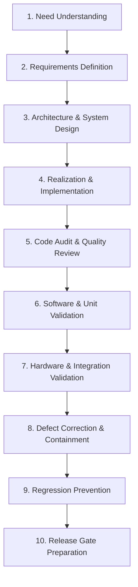

# Development Method: Evidence-Based Engineering

## 1. The 10 Engineering Phases
Engineering with an AI assistant must not be treated as casual text generation. To create maintainable, reliable software, development must progress through 10 formal phases:



1. **Need Understanding**: Clarify the problem, target personas, and constraints.
2. **Requirements Definition**: Establish prioritized, testable functional and non-functional requirements.
3. **Architecture & System Design**: Decompose modules, define contracts, and record ADRs.
4. **Realization & Implementation**: Write bounded, clean code strictly respecting architectural boundaries.
5. **Code Audit & Quality Review**: Objectively inspect committed code against requirements and safety rules.
6. **Software & Unit Validation**: Run automated unit and integration tests on host environments.
7. **Hardware & Integration Validation**: Execute acceptance tests on target silicon or physical devices.
8. **Defect Correction & Containment**: Diagnose root causes and apply minimal targeted fixes without feature creep.
9. **Regression Prevention**: Verify that previously working features remain intact via dedicated regression tests.
10. **Release Gate Preparation**: Evaluate Quality Gates and compile formal Go/No-Go release reports.

---

## 2. Evidence-Based Engineering Principles
- **No Hallucinated Proof**: Every claim must be supported by empirical documentation (terminal logs, test assertions, serial captures).
- **Compilation != Functionality**: Successful build indicates only grammatical and typing correctness; it provides zero guarantee of runtime success.
- **Traceability Chains**:
  ```text
  REQ-F-001 (Requirement)
      │
      ├── ADR-001 (Architectural Decision)
      │
      ├── src/engine.cpp (Implementation)
      │
      └── SYS-001 / MAT-001 (Verification Test)
  ```
- **Protected State**: Features once validated are permanently protected against regression unless an explicit architectural revision is approved.
