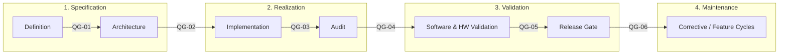

# Project Lifecycle Specification

## 1. Lifecycle Overview
The lifecycle of a project governed by the **CalmTechnology-DevToolkit** consists of four major developmental stages, bounded by 6 objective Quality Gates:

---

## 2. Stage Breakdown

### Stage 1: Specification
- **Activities**: Problem clarification, requirement prioritization, architectural modeling, ADR drafting.
- **Primary Documents**: `docs/PROJECT.md`, `docs/REQUIREMENTS.md`, `docs/ARCHITECTURE.md`, `docs/DECISIONS.md`.
- **Quality Gates**: QG-01 (Definition Ready), QG-02 (Architecture Ready).

### Stage 2: Realization
- **Activities**: Scoped prompt formulation, modular coding, toolchain compilation, static analysis, 10-step code audit.
- **Primary Documents**: `prompts/`, `docs/AUDIT_REPORT.md`, `docs/KNOWN_ISSUES.md`.
- **Quality Gates**: QG-03 (Build Ready), QG-04 (Audit Ready).

### Stage 3: Validation
- **Activities**: Test suite execution, hardware flashing, touch/screen/audio profiling, regression matrix runs.
- **Primary Documents**: `docs/TEST_PLAN.md`, `docs/TEST_RESULTS.md`, `docs/PROJECT_STATE.md`.
- **Quality Gates**: QG-05 (Validation Ready).

### Stage 4: Release & Maintenance
- **Activities**: Release checklist completion, release report authoring, defect diagnosis, corrective releases.
- **Primary Documents**: `docs/RELEASE_CHECKLIST.md`, `docs/RELEASE_REPORT.md`, `docs/CORRECTIVE_PLAN.md`.
- **Quality Gates**: QG-06 (Release Ready).
