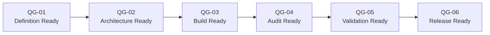

# Quality Gates Specification

## 1. Purpose
Quality Gates are formal, objective checkpoints that prevent premature advances, untested deployments, and unverified releases. Every project progressing through the **CalmTechnology-DevToolkit** must satisfy the applicable Quality Gates.

---

## 2. The Six Quality Gates

### QG-01 — Definition Ready
- **Focus**: Requirements Completeness & Scope Clarity.
- **Criteria**:
  - `docs/PROJECT.md` is populated with clear goals and out-of-scope boundaries.
  - All functional requirements (`REQ-F-xxx`) have priorities and testable acceptance criteria.
  - Non-functional requirements (`REQ-NF-xxx`) have quantifiable metrics.
  - Zero application code written during this phase.

### QG-02 — Architecture Ready
- **Focus**: Modular Design & Architectural Integrity.
- **Criteria**:
  - `docs/ARCHITECTURE.md` documents components, interfaces, and data flows.
  - Major technical choices are recorded as ADRs in `docs/DECISIONS.md`.
  - Embedded hardware constraints and memory budgets are documented.
  - Initial test plan `docs/TEST_PLAN.md` is populated with status `NOT_RUN`.

### QG-03 — Build Ready
- **Focus**: Compilation & Toolchain Cleanliness.
- **Criteria**:
  - Code compiles cleanly across all applicable toolchains (GCC, Clang, PlatformIO, etc.).
  - Zero compiler errors; zero unaddressed critical warnings.

### QG-04 — Audit Ready
- **Focus**: Code Quality, Security, and Regression Prevention.
- **Criteria**:
  - Source code audit completed following the 10-step protocol.
  - `docs/AUDIT_REPORT.md` produced.
  - Zero open `CRITICAL` or `HIGH` severity defects.
  - Validated features listed in `docs/PROJECT_STATE.md` remain uncompromised.

### QG-05 — Validation Ready
- **Focus**: Empirical Verification & Test Evidence.
- **Criteria**:
  - 100% of P0 functional requirements verified via passing tests in `docs/TEST_RESULTS.md`.
  - Non-regression tests (`REG-xxx`) executed with zero failures.
  - If embedded target: physical hardware acceptance tests (`MAT-xxx`) executed and documented.
  - Zero tests hallucinated or falsely marked PASS without terminal evidence.

### QG-06 — Release Ready
- **Focus**: Release Transparency & Packaging.
- **Criteria**:
  - `docs/RELEASE_CHECKLIST.md` completed.
  - Version consistency verified across `VERSION`, `CHANGELOG.md`, and build configs.
  - License present; zero committed secrets or API tokens verified.
  - Formal release report `docs/RELEASE_REPORT.md` issued with justified decision (`GO`, `CONDITIONAL_GO`, `NO_GO`, `INSUFFICIENT_EVIDENCE`).

---

## 3. Authorized Evaluation Statuses
`docs/QUALITY_GATES.md` serves as the sole normative reference for Quality Gate evaluation statuses. Every Quality Gate must receive exactly one of the following five authorized formal statuses:

| Status | Meaning / Criteria |
|---|---|
| **`PASS`** | All mandatory applicable conditions for this gate are fully satisfied with verifiable evidence. |
| **`FAIL`** | At least one mandatory condition has been evaluated and is not satisfied. |
| **`BLOCKED`** | Gate evaluation or validation is prevented by an identified missing prerequisite (e.g., missing equipment, blocking defect). |
| **`NOT_EVALUATED`** | The checkpoint has not yet been evaluated for the current version or milestone. |
| **`NOT_APPLICABLE`** | The checkpoint does not apply to the current project type or configuration, with documented justification. |

---

## 4. Strict Separation of State Categories

To ensure unambiguous communication and epistemic rigor, the following six state categories must NEVER be confused or interchanged:

1. **Quality Gate Status**: Evaluates gate criteria (`PASS`, `FAIL`, `BLOCKED`, `NOT_EVALUATED`, `NOT_APPLICABLE`).
2. **Test Execution Status**: Outcome of a test case (`NOT_RUN`, `PASS`, `FAIL`, `BLOCKED`, `NOT_APPLICABLE`).
3. **Development Phase**: Active lifecycle stage (`DEFINITION`, `ARCHITECTURE`, `IMPLEMENTATION`, `AUDIT`, `VALIDATION`, `RELEASE_READY`, etc.).
4. **Defect Status**: Issue tracking state (`OPEN`, `UNDER_INVESTIGATION`, `FIX_PROPOSED`, `RESOLVED`, `WONT_FIX`).
5. **Release Decision**: Verdict of a release review (`GO`, `CONDITIONAL_GO`, `NO_GO`, `INSUFFICIENT_EVIDENCE`).
6. **Evidence Provenance**: Origin and reliability of claims (`DIRECTLY_VERIFIED`, `USER_REPORTED`, `EXTERNAL_REPORTED`, `ILLUSTRATIVE`, `UNVERIFIED`).

> [!IMPORTANT]
> - `INSUFFICIENT_EVIDENCE` is strictly a **Release Decision** (or finding evaluation), NOT an authorized Quality Gate status.
> - `IN_PROGRESS` describes ongoing activity or phase progress; it must NEVER be used as a Quality Gate evaluation status (use `BLOCKED` or `NOT_EVALUATED` until formal evaluation).
> - `PENDING` is obsolete and must be resolved to either `NOT_EVALUATED` (if awaiting campaign start) or `BLOCKED` (if prevented by an unfulfilled prerequisite).
