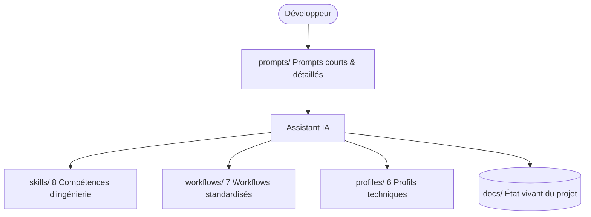

# Guide d'utilisation complet — CalmTechnology-DevToolkit

## 1. Introduction et méthodologie
**CalmTechnology-DevToolkit** est un cadre méthodologique conçu pour transformer le développement assisté par IA en un processus d'ingénierie prévisible, rigoureux et fondé sur les preuves.

### Les dérives du développement non cadré (« vibe-coding »)
Lorsque le développement avec une IA s'effectue sans cadre strict :
- Les décisions d'architecture sont oubliées dès que la fenêtre de contexte de l'IA est réinitialisée.
- Des fonctionnalités opérationnelles sont écrasées ou altérées silencieusement.
- Des tests inexistants sont déclarés réussis uniquement parce que la compilation ne signale pas d'erreur.
- Les contraintes physiques (mémoire SRAM, rotation d'écran, FreeRTOS) sont négligées jusqu'au plantage sur le matériel.

### La solution : la mémoire documentaire persistante
CalmTechnology-DevToolkit dissocie l'état du projet de l'historique temporaire des conversations en maintenant une **mémoire documentaire vivante** sous Git dans le dossier `docs/`.

---

## 2. Les composantes du toolkit



### 2.1 Les 8 compétences d'ingénierie (`skills/`)
Chaque compétence représente un rôle spécialisé régi par un contrat formel en 12 sections :
1. `project-definition` : Transforme les besoins en exigences testables (`REQ-F-xxx`, `REQ-NF-xxx`).
2. `software-architect` : Décompose le système en composants, interfaces et fiches de décision (`ADR-xxx`).
3. `embedded-engineer` : Veille sur la mémoire (SRAM, PSRAM), les tâches FreeRTOS et les périphériques.
4. `ui-designer` : Spécifie les interfaces et leurs 4 états (Normal, Occupé, Erreur, Désactivé).
5. `prompt-generator` : Génère des prompts de réalisation et de correction strictement bornés.
6. `code-auditor` : Conduit l'audit méthodique en 10 étapes du code réel.
7. `test-engineer` : Conçoit la stratégie de test et consigne les preuves réelles.
8. `release-reviewer` : Évalue formellement le Quality Gate QG-06 et formule la décision de publication (`GO`, `CONDITIONAL_GO`, `NO_GO`, `INSUFFICIENT_EVIDENCE`).

### 2.2 Les 7 workflows opérationnels (`workflows/`)
- `new-project.md` : De l'idée initiale à la release MVP.
- `existing-project.md` : Importation d'un projet existant sans modification de code durant l'import.
- `feature-development.md` : Ajout d'une fonctionnalité en protégeant l'existant.
- `code-audit.md` : Revue de code formelle en 10 étapes.
- `corrective-release.md` : Correction ciblée avec test de non-régression (`REG-xxx`).
- `regression-testing.md` : Campagne de validation avant publication.
- `public-release.md` : Revue formelle des Quality Gates et rapport de publication.

---

## 3. Déploiement partagé multi-projets

Le toolkit est conçu pour être partagé entre plusieurs projets sans duplication :

```text
Documents/
└── Antigravity-5.1/
    ├── CalmTechnology-DevToolkit/   # Boîte à outils méthodologique partagée
    ├── ProjetA/                     # Projet cible (avec ses propres docs/ et src/)
    └── ProjetB/                     # Projet cible (avec ses propres docs/ et src/)
```

- Fournissez le chemin relatif (ex. `../CalmTechnology-DevToolkit`) ou absolu dans votre prompt.
- **Règle d'inaccessibilité** : Si l'assistant ne peut pas accéder au dossier du toolkit, il doit obligatoirement le signaler plutôt que de faire semblant d'appliquer la méthode.

---

## 4. Mode d'utilisation minimal en 9 étapes

L'utilisateur n'a pas à sélectionner manuellement des dizaines de fichiers pour chaque opération courante :
1. **Identifier le projet cible** : Ouvrir ou désigner le répertoire du projet.
2. **Lire `AGENTS.md`** : Établir les règles d'engagement de l'assistant.
3. **Lire `docs/PROJECT_STATE.md`** : Consulter la vérité vivante du projet.
4. **Identifier le workflow** : Aligner la tâche sur le cycle de vie applicable.
5. **Charger la compétence principale** : Charger sélectivement la compétence et le profil requis.
6. **Examiner les fichiers pertinents** : Lire le code réel, les configurations et les tests.
7. **Réaliser la tâche autorisée** : Exécuter la modification sans dérive de périmètre.
8. **Mettre à jour les documents concernés** : Répercuter les changements dans `PROJECT_STATE.md` et les registres associés.
9. **Présenter un résumé concis** : Fournir un compte-rendu transparent et proportionné.

---

## 5. Matrice de chargement sélectif des documents

| Demande de l'utilisateur | Workflow actif | Compétence principale | Modèles et profils pertinents |
|---|---|---|---|
| Initialiser un nouveau projet | `workflows/new-project.md` | `skills/project-definition` | `templates/PROJECT.md`, `REQUIREMENTS.md`, profil |
| Importer un projet existant | `workflows/existing-project.md` | `skills/code-auditor` | `templates/PROJECT_STATE.md`, `KNOWN_ISSUES.md` |
| Ajouter une fonctionnalité | `workflows/feature-development.md` | `skills/software-architect` | `prompts/generate-development-prompt.md`, profil |
| Auditer le code source | `workflows/code-audit.md` | `skills/code-auditor` | `templates/AUDIT_REPORT.md`, `KNOWN_ISSUES.md` |
| Corriger une anomalie | `workflows/corrective-release.md` | `skills/code-auditor` | `prompts/generate-corrective-prompt.md`, `CORRECTIVE_PLAN.md` |
| Valider les modifications / tests | `workflows/regression-testing.md` | `skills/test-engineer` | `templates/TEST_PLAN.md`, `TEST_RESULTS.md` |
| Préparer la revue de publication | `workflows/public-release.md` | `skills/release-reviewer` | `templates/RELEASE_CHECKLIST.md`, `RELEASE_REPORT.md` |

---

## 6. Les 3 situations courantes

### Situation A — Créer un nouveau projet
Transmettez le prompt court :
```text
Utilise CalmTechnology-DevToolkit.
Initialise la documentation de ce projet selon le workflow new-project.
Ne commence pas à programmer.
```
Suivez la phase interactive de définition, spécifiez les exigences dans `docs/REQUIREMENTS.md` et validez le Quality Gate QG-01.

### Situation B — Importer un projet existant
Transmettez le prompt court :
```text
Utilise CalmTechnology-DevToolkit.
Examine ce projet existant et initialise sa documentation à partir du code réel.
Ne modifie aucun fichier source.
```
L'assistant examine le code réel, reconstruit l'état initial dans `docs/PROJECT_STATE.md` et formule la prochaine étape sans modifier le code.

### Situation C — Continuer un projet déjà intégré
Transmettez le prompt court :
```text
Utilise CalmTechnology-DevToolkit.
Lis PROJECT_STATE.md, vérifie l'état réel du projet et propose la prochaine étape.
Ne modifie pas le code.
```
L'assistant s'aligne sur la vérité du projet, vérifie les fonctionnalités protégées et propose la tâche suivante.

---

## 7. Responsabilité unique des documents et mises à jour proportionnées

Pour préserver la clarté documentaire sans alourdir le développement :
- Ne réécrivez pas l'intégralité des documents après une modification locale.
- Utilisez des identifiants stables (`REQ-xxx`, `ADR-xxx`, `ISSUE-xxx`, `SYS-xxx`) pour référencer les détails.
- Gardez `PROJECT_STATE.md` concis et synthétique.

| Document | Responsabilité principale |
|---|---|
| `PROJECT.md` | Identité, objectifs, périmètre et limites |
| `REQUIREMENTS.md` | Exigences fonctionnelles/non-fonctionnelles et critères d'acceptation |
| `ARCHITECTURE.md` | Décomposition modulaire, contrats, flux de données |
| `DECISIONS.md` | Décisions d'architecture documentées (ADR) |
| `PROJECT_STATE.md` | Synthèse vivante de l'état actuel, fonctionnalités validées, prochaine étape |
| `TEST_PLAN.md` | Catalogue des tests prévus et protocoles |
| `TEST_RESULTS.md` | Résultats de tests observés, horodatages, métriques et provenance |
| `KNOWN_ISSUES.md` | Registre des anomalies avérées et suivi de résolution |

---

## 8. Rigueur des preuves et séparation des statuts

### Statuts des Quality Gates vs Décisions de publication
- **Statuts autorisés des Quality Gates** (`docs/QUALITY_GATES.md`) : Strictement `PASS`, `FAIL`, `BLOCKED`, `NOT_EVALUATED`, `NOT_APPLICABLE`.
- **Décisions exécutives de publication** : `GO`, `CONDITIONAL_GO`, `NO_GO`, `INSUFFICIENT_EVIDENCE`.

### Statuts des tests et provenance des preuves
- **Statuts d'exécution des tests** : `NOT_RUN`, `PASS`, `FAIL`, `BLOCKED`, `NOT_APPLICABLE`.
- **Catégories de provenance** : `DIRECTLY_VERIFIED`, `USER_REPORTED`, `EXTERNAL_REPORTED`, `ILLUSTRATIVE`, `UNVERIFIED`.
- Tout test non entrepris est strictement `NOT_RUN` (ou `BLOCKED` en cas d'absence de matériel). Le succès de compilation ne vaut jamais validation fonctionnelle à l'exécution.
