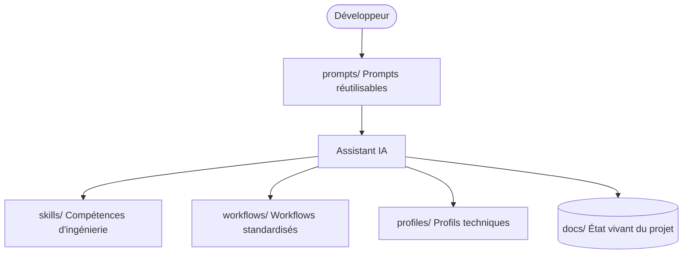

# Guide d'utilisation complet — CalmTechnology-DevToolkit

## 1. Introduction et méthodologie
**CalmTechnology-DevToolkit** est un cadre méthodologique conçu pour transformer le développement assisté par IA en un processus d'ingénierie prévisible, rigoureux et fondé sur les preuves.

### Les dérives du développement non cadré (« vibe-coding »)
Lorsque le développement avec une IA s'effectue sans cadre strict :
- Les décisions d'architecture sont oubliées dès que la fenêtre de contexte de l'IA est réinitialisée.
- Des fonctionnalités opérationnelles sont écrasées ou altérées silencieusement.
- Des tests inexistants sont déclarés réussis uniquement parce que la compilation ne signale pas d'erreur.
- Les contraintes physiques (mémoire SRAM, rotation d'écran, FreeRTOS) sont négligées jusqu'au plantage sur le matériel.

### La solution : la mémoire documentaire persistante
CalmTechnology-DevToolkit dissocie l'état du projet de l'historique temporaire des conversations en maintenant une **mémoire documentaire vivante** sous Git dans le dossier `docs/`.

---

## 2. Les composantes du toolkit

### 2.1 Les 8 compétences d'ingénierie (`skills/`)
Chaque compétence représente un rôle spécialisé régi par un contrat formel en 12 sections :
1. `project-definition` : Transforme les besoins en exigences testables (`REQ-F-xxx`, `REQ-NF-xxx`).
2. `software-architect` : Décompose le système en composants, interfaces et fiches de décision (`ADR-xxx`).
3. `embedded-engineer` : Veille sur la mémoire (SRAM, PSRAM), les tâches FreeRTOS et les périphériques.
4. `ui-designer` : Spécifie les interfaces et leurs 4 états (Normal, Occupé, Erreur, Désactivé).
5. `prompt-generator` : Génère des prompts de réalisation et de correction strictement bornés.
6. `code-auditor` : Conduit l'audit méthodique en 10 étapes du code réel.
7. `test-engineer` : Conçoit la stratégie de test et consigne les preuves réelles.
8. `release-reviewer` : Évalue formellement la publication (`GO`, `CONDITIONAL_GO`, `NO_GO`, `INSUFFICIENT_EVIDENCE`).

### 2.2 Les 7 workflows opérationnels (`workflows/`)
- `new-project.md` : De l'idée initiale à la release MVP.
- `existing-project.md` : Importation d'un projet existant sans modification de code durant l'import.
- `feature-development.md` : Ajout d'une fonctionnalité en protégeant l'existant.
- `code-audit.md` : Revue de code formelle en 10 étapes.
- `corrective-release.md` : Correction ciblée avec test de non-régression (`REG-xxx`).
- `regression-testing.md` : Campagne de validation avant publication.
- `public-release.md` : Revue formelle des Quality Gates et rapport de publication.

---

## 3. Le document central : `docs/PROJECT_STATE.md`
`PROJECT_STATE.md` est le document le plus important de votre dépôt :
- **Fonctionnalités validées** : Liste des fonctionnalités éprouvées par des tests réussis. Elles sont strictement protégées.
- **Travaux en cours** : Code en développement ou en attente de validation matérielle.
- **Anomalies ouvertes** : Synthèse issue de `KNOWN_ISSUES.md`.
- **Prochaine action recommandée** : Guide sans ambiguïté la prochaine intervention technique.

---

## 4. Bonnes pratiques de collaboration avec l'IA
1. **Lisez `PROJECT_STATE.md` au début de chaque session**.
2. **Ne commencez jamais à coder sans exigences formelles préalables**.
3. **Exigez des preuves de tests physiques pour l'embarqué** : Pour l'ESP32 ou le CoreS3, des tests matériels (`MAT-xxx`) sont indispensables avant toute release publique.
4. **Isolez strictement les corrections de bugs** : N'introduisez jamais de nouvelle fonctionnalité lors d'un cycle correctif.
