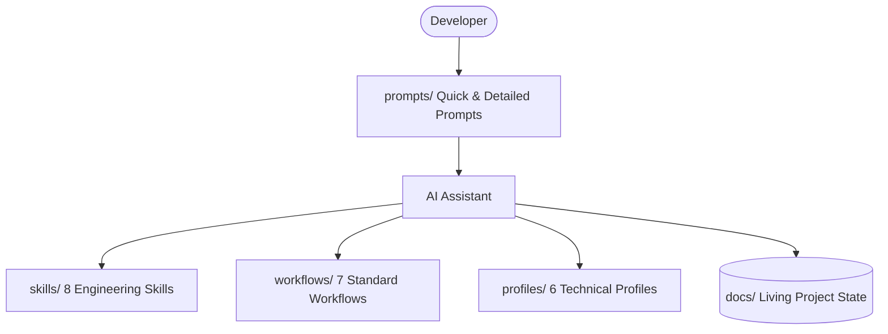

# User Guide: CalmTechnology-DevToolkit

## 1. Introduction & Methodology
**CalmTechnology-DevToolkit** is an engineering framework designed to transform chaotic AI code generation into a predictable, disciplined, and evidence-based software lifecycle.

### The Problem with "Vibe-Coding"
When developers prompt AI models without methodological boundaries:
- Architectural decisions are forgotten after conversation context windows reset.
- Working features are overwritten or silently regressed.
- Tests are hallucinated or declared passing simply because a compiler didn't throw an error.
- Hardware constraints (SRAM limits, DMA requirements, display rotation) are overlooked until hardware crashes occur.

### The Calm Technology Solution
CalmTechnology-DevToolkit decouples project knowledge from transient chat windows by maintaining a persistent **Living Project Memory** inside version-controlled Markdown files in `docs/`.

---

## 2. Navigating the Toolkit Components



### 2.1 The 8 Specialized Skills (`skills/`)
Each skill represents a specialized engineering role governed by a strict 12-section contract:
1. `project-definition`: Turns ideas into testable requirements (`REQ-F-xxx`, `REQ-NF-xxx`).
2. `software-architect`: Decomposes systems into modules, interfaces, and ADRs (`ADR-xxx`).
3. `embedded-engineer`: Enforces memory budgets (SRAM, PSRAM), RTOS tasks, and hardware limits.
4. `ui-designer`: Formulates stateful (Normal/Busy/Error/Disabled) UI specs for LVGL, Web, or Electron.
5. `prompt-generator`: Writes laser-focused, bounded prompts for implementation and bugfixes.
6. `code-auditor`: Performs objective 10-step inspections of real source code.
7. `test-engineer`: Establishes test plans and records empirical test evidence.
8. `release-reviewer`: Impartially evaluates Quality Gate QG-06 and issues release verdicts (`GO`, `CONDITIONAL_GO`, `NO_GO`, `INSUFFICIENT_EVIDENCE`).

### 2.2 The 7 Workflows (`workflows/`)
- `new-project.md`: From greenfield concept to validated MVP release.
- `existing-project.md`: Onboarding brownfield code without modifying source during import.
- `feature-development.md`: Safely adding new capabilities without regressing existing features.
- `code-audit.md`: Formal 10-step source code review.
- `corrective-release.md`: Targeted, bounded bug fixing with dedicated regression tests (`REG-xxx`).
- `regression-testing.md`: Comprehensive verification before releases.
- `public-release.md`: Formal release gate review and public disclosures.

---

## 3. Shared Workspace Setup & Path Resolution

The toolkit is designed to be shared across multiple projects without duplicating repositories:

```text
Documents/
└── Antigravity-5.1/
    ├── CalmTechnology-DevToolkit/   # Shared toolkit
    ├── ProjectA/                    # Target project with own docs/ and src/
    └── ProjectB/                    # Target project with own docs/ and src/
```

- In your prompt, provide the relative path (e.g., `../CalmTechnology-DevToolkit`) or absolute path.
- **Inaccessibility Reporting**: If the assistant cannot access the toolkit path, it must report the issue rather than hallucinating rules.

---

## 4. Minimal Daily Operating Procedure (9 Steps)

You do not need to manually select dozens of files for routine tasks. Follow this 9-step operating cycle:
1. **Identify Target Project**: Open or point to the project directory.
2. **Read `AGENTS.md`**: Establish operational rules of engagement.
3. **Read `docs/PROJECT_STATE.md`**: Consult the living project truth.
4. **Identify the Workflow**: Match user intent to the lifecycle path.
5. **Load Primary Skill**: Selectively load only the required skill and profile.
6. **Examine Relevant Files**: Inspect actual code, build configs, or tests.
7. **Perform Authorized Task**: Execute bounded changes with zero scope creep.
8. **Update Affected Documents**: Record changes in `PROJECT_STATE.md` and related files.
9. **Present Concise Summary**: Provide transparent, proportional reporting.

---

## 5. Selective Document Loading Matrix

| User Request | Active Workflow | Primary Skill | Relevant Templates & Profiles |
|---|---|---|---|
| Initialize new project | `workflows/new-project.md` | `skills/project-definition` | `templates/PROJECT.md`, `REQUIREMENTS.md`, profile |
| Import existing codebase | `workflows/existing-project.md` | `skills/code-auditor` | `templates/PROJECT_STATE.md`, `KNOWN_ISSUES.md` |
| Add new feature | `workflows/feature-development.md` | `skills/software-architect` | `prompts/generate-development-prompt.md`, profile |
| Audit source code | `workflows/code-audit.md` | `skills/code-auditor` | `templates/AUDIT_REPORT.md`, `KNOWN_ISSUES.md` |
| Fix a defect | `workflows/corrective-release.md` | `skills/code-auditor` | `prompts/generate-corrective-prompt.md`, `CORRECTIVE_PLAN.md` |
| Validate changes / tests | `workflows/regression-testing.md` | `skills/test-engineer` | `templates/TEST_PLAN.md`, `TEST_RESULTS.md` |
| Prepare release review | `workflows/public-release.md` | `skills/release-reviewer` | `templates/RELEASE_CHECKLIST.md`, `RELEASE_REPORT.md` |

---

## 6. The 3 Common Everyday Situations

### Situation A — Creating a New Project
Send the quick prompt:
```text
Utilise CalmTechnology-DevToolkit.
Initialise la documentation de ce projet selon le workflow new-project.
Ne commence pas à programmer.
```
Follow the interactive definition phase, formulate requirements in `docs/REQUIREMENTS.md`, and evaluate Gate QG-01.

### Situation B — Importing an Existing Codebase
Send the quick prompt:
```text
Utilise CalmTechnology-DevToolkit.
Examine ce projet existant et initialise sa documentation à partir du code réel.
Ne modifie aucun fichier source.
```
The assistant inspects actual code, reconstructs baseline state in `docs/PROJECT_STATE.md`, and identifies next actions without editing source code.

### Situation C — Resuming an Integrated Project
Send the quick prompt:
```text
Utilise CalmTechnology-DevToolkit.
Lis PROJECT_STATE.md, vérifie l'état réel du projet et propose la prochaine étape.
Ne modifie pas le code.
```
The assistant syncs on current truth, checks validated protected features, and proposes bounded execution.

---

## 7. Document Single Responsibility & Proportional Updates

To keep documentation lean and actionable:
- Do not rewrite every document after a localized fix.
- Use stable IDs (`REQ-xxx`, `ADR-xxx`, `ISSUE-xxx`, `SYS-xxx`) to reference details.
- Keep `PROJECT_STATE.md` concise.

| Document | Primary Responsibility |
|---|---|
| `PROJECT.md` | Identity, objectives, scope boundaries |
| `REQUIREMENTS.md` | Functional & non-functional requirements and acceptance criteria |
| `ARCHITECTURE.md` | Modular decomposition, contracts, data flows |
| `DECISIONS.md` | Architecture Decision Records (ADRs) |
| `PROJECT_STATE.md` | Living synthesis of current state, validated capabilities, next action |
| `TEST_PLAN.md` | Catalog of specified test cases |
| `TEST_RESULTS.md` | Empirical test execution logs, timestamps, metrics, provenance |
| `KNOWN_ISSUES.md` | Confirmed defects and resolution tracking |

---

## 8. Evidence Rigor & Status Separation

### Quality Gate Statuses vs Release Decisions
- **Quality Gate Statuses** (`docs/QUALITY_GATES.md`): Strictly `PASS`, `FAIL`, `BLOCKED`, `NOT_EVALUATED`, `NOT_APPLICABLE`.
- **Release Decisions**: `GO`, `CONDITIONAL_GO`, `NO_GO`, `INSUFFICIENT_EVIDENCE`.

### Test Execution Statuses & Evidence Provenance
- **Test Statuses**: `NOT_RUN`, `PASS`, `FAIL`, `BLOCKED`, `NOT_APPLICABLE`.
- **Evidence Provenance**: `DIRECTLY_VERIFIED`, `USER_REPORTED`, `EXTERNAL_REPORTED`, `ILLUSTRATIVE`, `UNVERIFIED`.
- An unexecuted test is strictly `NOT_RUN` (or `BLOCKED`). Successful compilation does not prove runtime validity.
