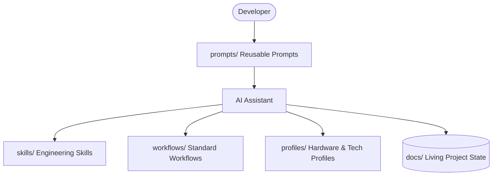

# User Guide: CalmTechnology-DevToolkit

## 1. Introduction & Methodology
**CalmTechnology-DevToolkit** is an engineering framework designed to transform chaotic AI code generation into a predictable, disciplined, and evidence-based software lifecycle.

### The Problem with "Vibe-Coding"
When developers prompt AI models without methodological boundaries:
- Architectural decisions are forgotten after conversation context windows reset.
- Working features are overwritten or silently regressed.
- Tests are hallucinated or declared passing simply because a compiler didn't throw an error.
- Hardware constraints (SRAM limits, DMA requirements, display rotation) are overlooked until hardware crashes occur.

### The Calm Technology Solution
CalmTechnology-DevToolkit decouples project knowledge from transient chat windows by maintaining a persistent **Living Project Memory** inside version-controlled Markdown files in `docs/`.

---

## 2. Navigating the Toolkit Components

### 2.1 The 8 Specialized Skills (`skills/`)
Each skill represents a specialized engineering role governed by a strict 12-section contract. You can invoke skills individually or let workflows sequence them:
1. `project-definition`: Turns ideas into testable requirements (`REQ-F-xxx`, `REQ-NF-xxx`).
2. `software-architect`: Decomposes systems into modules, interfaces, and ADRs (`ADR-xxx`).
3. `embedded-engineer`: Enforces memory budgets (SRAM, PSRAM), RTOS tasks, and hardware limits.
4. `ui-designer`: Formulates stateful (Normal/Busy/Error/Disabled) UI specs for LVGL, Web, or Electron.
5. `prompt-generator`: Writes laser-focused, bounded prompts for implementation and bugfixes.
6. `code-auditor`: Performs objective 10-step inspections of real source code.
7. `test-engineer`: Establishes test plans and records empirical test evidence.
8. `release-reviewer`: Impartially evaluates Quality Gate QG-06 (`GO`, `CONDITIONAL_GO`, `NO_GO`, `INSUFFICIENT_EVIDENCE`).

### 2.2 The 7 Workflows (`workflows/`)
Workflows provide prescriptive paths through the engineering lifecycle:
- `new-project.md`: From greenfield concept to validated MVP release.
- `existing-project.md`: Onboarding brownfield code without modifying source during import.
- `feature-development.md`: Safely adding new capabilities without regressing existing features.
- `code-audit.md`: Formal 10-step source code review.
- `corrective-release.md`: Targeted, bounded bug fixing with dedicated regression tests (`REG-xxx`).
- `regression-testing.md`: Comprehensive verification before releases.
- `public-release.md`: Formal release gate review and public disclosures.

---

## 3. Maintaining the Living Project State (`PROJECT_STATE.md`)
The single most important document in your repository is `docs/PROJECT_STATE.md`. It must be maintained with complete accuracy:
- **Validated Features**: Once a feature is proven operational via passing test suites, it is entered here. Validated features are strictly protected from opportunistic rewrites.
- **Unvalidated Work**: Code currently under development or awaiting hardware verification.
- **Defects Summary**: Count of open issues from `KNOWN_ISSUES.md`.
- **Recommended Next Action**: Eliminates ambiguity on what the developer or AI assistant should work on next.

---

## 4. Best Practices for Developers Working with AI
1. **Never start a turn without pointing to `PROJECT_STATE.md`**.
2. **Review before merging**: Use `workflows/code-audit.md` before merging pull requests.
3. **Enforce hardware testing for embedded targets**: If you are developing for ESP32 or CoreS3, insist on physical validation (`MAT-xxx`) before tagging a release.
4. **Resist feature bundling in bug fixes**: When fixing a bug, keep the prompt laser-focused on the defect locus.
