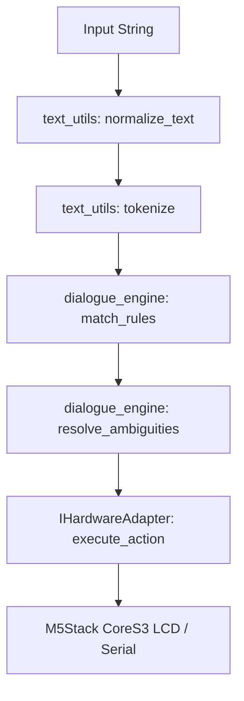

# Architecture Specification: CoreS3-RuleBot

## 1. System Architecture Overview
CoreS3-RuleBot uses a modular, layered architecture that strictly separates pure C++17 domain logic from hardware-specific drivers.

```text
User Input (Serial / Touch / Simulated)
    │
    ▼
Text Normalizer (UTF-8 diacritics stripping, case folding, elisions)
    │
    ▼
Tokenizer (whitespace splitting, token vectorization)
    │
    ▼
Rule Matcher (constexpr keyword tables, bounded Levenshtein distance)
    │
    ▼
Intent Resolver (ambiguity resolution, negation filtering)
    │
    ▼
Response Selector (deterministic template selection)
    │
    ▼
Hardware Adapter / User Output (LCD, Serial, or PC Console)
```

---

## 2. Comparative Analysis of Recognition Approaches
To select the optimal dialogue matching algorithm for M5Stack CoreS3, six technical approaches were formally evaluated against embedded constraints:

| Evaluation Criteria | 1. Char Transition Matrix (DFA) | 2. Word Transition Graph | 3. Prefix Trie | 4. Token-Based Keyword Rules | 5. Bounded Edit Distance (Levenshtein) | 6. Synonym Hash Dictionary |
|---|---|---|---|---|---|---|
| **Memory Footprint** | Poor (sparse 2D matrix explosion) | Moderate (node pointers) | Good (compact tree) | **Excellent** (flat constexpr tables) | Good (small dynamic matrix: 2 rows) | Moderate (hash table buckets overhead) |
| **Algorithmic Complexity** | O(N) linear in characters | O(W) in words | O(N) in characters | **O(T * K)** (Tokens * Keywords) | O(M * N) bounded to short words | O(1) average lookup |
| **Ease of Adding Rules** | Very Difficult (re-compile DFA) | Moderate | Moderate (re-insert) | **Trivial** (append to JSON/array) | Easy (adjust threshold) | Easy (insert key-value) |
| **Typo Tolerance** | None without exponential states | None | Low (fuzzy trie is memory-heavy) | None (exact match only) | **High** (handles 1-2 char slips) | None (requires all misspellings) |
| **Determinism** | 100% Deterministic | 100% Deterministic | 100% Deterministic | **100% Deterministic** | 100% Deterministic | 100% Deterministic |
| **Risk of False Positives**| Zero | Zero | Zero | **Low** | **Moderate** (can match unrelated words) | Low |
| **Maintenance on MCU** | Extremely Complex | Complex | Moderate | **Very Simple** | Very Simple | Simple |

### Architectural Decision Synthesis
- **Pure Levenshtein**: Suffers from false positives (e.g., matching "salade" when looking for "salut").
- **Pure Trie**: Lacks natural typo tolerance and parameter extraction.
- **Chosen Hybrid Architecture (`ADR-001`)**:
  1. Fast tokenization and exact matching on primary keyword tokens.
  2. Fallback to **bounded Levenshtein distance (max distance = 1)** *only* for tokens of length >= 4 characters, with an exclusion list of common confusing words.
  3. Pre-compiled `constexpr` keyword tables generated from declarative `rules.json` stored in Flash memory.

---

## 3. Component Decomposition



### 3.1 Text Normalizer (`engine/text_utils`)
- Operates on UTF-8 bytes.
- Converts uppercase ASCII and accented UTF-8 characters (`é`, `è`, `ê`, `à`, `ç`, etc.) to lowercase unaccented ASCII equivalents.
- Replaces punctuation with single spaces.
- Strips French apostrophes/elisions (`l'heure` -> `l heure`, `d'accord` -> `d accord`).

### 3.2 Hardware Abstraction Layer (`engine/hardware_adapter.hpp`)
- `IHardwareAdapter`: Pure virtual interface declaring `get_time()`, `set_brightness()`, `get_wifi_status()`.
- Implemented as `MockAdapter` for PC simulator and `CoreS3Adapter` for physical M5Stack CoreS3.
