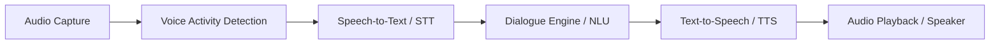
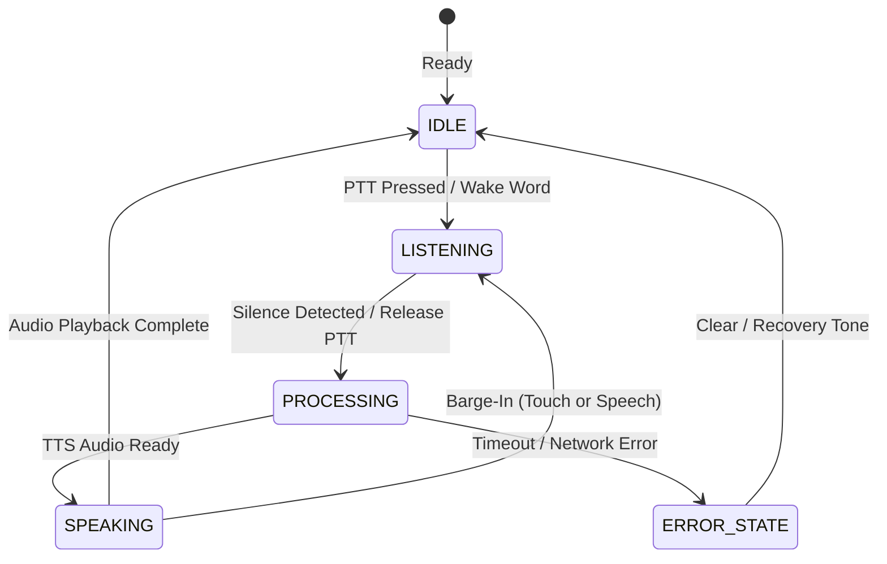

# Technical Profile: Voice Application & Audio Interaction

## 1. Voice Interaction Pipeline Architecture
Voice applications involve a tightly coordinated real-time pipeline spanning audio capture, speech detection, transcription, intention resolution, response synthesis, and audio playback.

---

## 2. Core Functional Concerns

### 2.1 Audio Capture & Sampling
- **Standard Voice Format**: 16 kHz, 16-bit signed PCM, mono.
- **DMA Buffer Sizing**: Ping-pong double buffers (minimum 512 bytes each) in internal SRAM to prevent audio frame dropping.
- **Acoustic Noise Floor**: Calibrate ambient noise thresholds during boot.

### 2.2 Voice Activity Detection (VAD) & Silence Detection
- Implement energy-based or zero-crossing rate VAD for embedded devices.
- Define explicit silence timeout (typically 800 ms to 1500 ms) to trigger end-of-speech.
- Avoid premature cut-off on short speech pauses.

### 2.3 Interaction Modes: Push-to-Talk vs. Wake Word
- **Push-to-Talk (PTT)**: Deterministic, zero false positives, highly recommended for resource-constrained or noisy environments.
- **Wake Word / Continuous Listening**: Requires lightweight embedded wake-word engine (e.g., microWakeWord) running on Core 0. High memory and CPU impact.

### 2.4 Barge-In & Interruption Handling
- When the user speaks or touches the display while the system is speaking (TTS playback):
  1. Immediately stop audio playback buffer transmission.
  2. Clear current TTS queue.
  3. Transition FSM state from `SPEAKING` to `LISTENING`.

### 2.5 Reconnection, Timeouts, and Provider Fallbacks
- Set network request timeouts (typically 4.0s for remote STT/TTS).
- Provide clear visual/audio feedback when connection drops.
- Support local fallback responses (e.g., pre-recorded audio or offline rule-based dialogue) when offline.

---

## 3. Audio Finite State Machine (FSM)

---

## 4. Latency Budgeting
| Pipeline Stage | Target Latency (Local) | Target Latency (Cloud) |
|---|---|---|
| Audio Capture & VAD | < 50 ms | < 50 ms |
| Speech-to-Text (STT) | < 200 ms (Local small) | 400 - 900 ms (Cloud API) |
| Intent Resolution / Engine | < 20 ms | 100 - 300 ms |
| Text-to-Speech (TTS) | < 150 ms (Local synthesis) | 300 - 800 ms (Cloud stream) |
| Audio Playback Start | < 50 ms | < 50 ms |
| **Total Round-Trip** | **< 470 ms** | **< 2100 ms** |

---

## 5. Security & API Credential Protection
- Never store raw API keys in firmware source code or unencrypted flash.
- Use NVS encryption or device-specific provisioning mechanisms.
- In desktop/web apps, proxy voice API requests through an authenticated backend.
