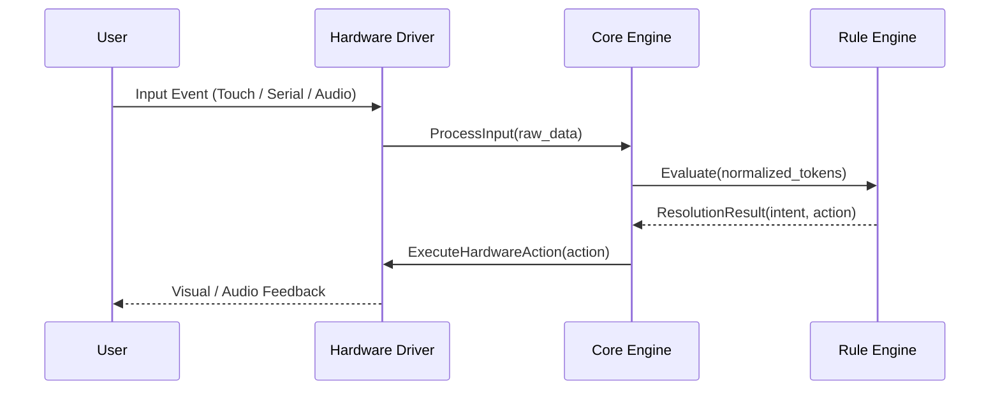
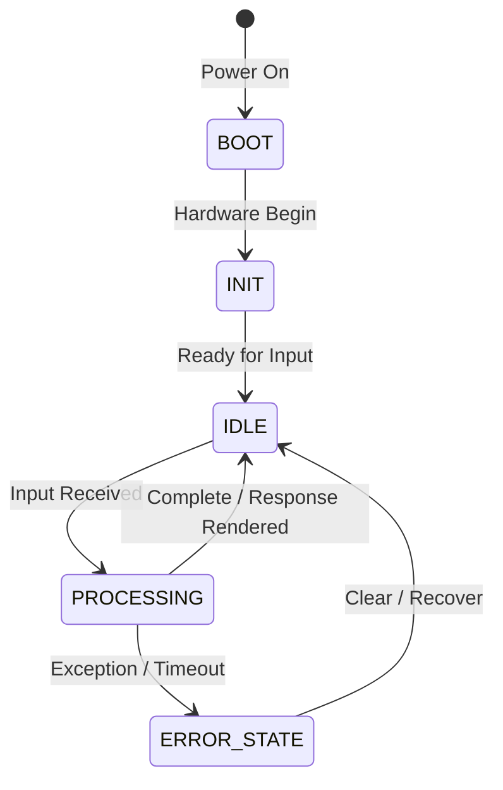

# Architecture Specification: [Project Name]

## 1. High-Level System Architecture
*Provide a concise architectural overview and high-level block diagram.*

```mermaid
flowchart TD
    UI[User Interface / Hardware I/O] --> ENGINE[Core Engine Subsystem]
    ENGINE --> LOGIC[Domain Rules / Processors]
    ENGINE --> HAL[Hardware Abstraction Layer (HAL)]
    HAL --> DRIVERS[Physical Hardware / Peripherals]
```

---

## 2. Component Decomposition & Responsibilities

| Component | Responsibility | Public Interface / Header | Dependencies |
|---|---|---|---|
| `[Component 1]` | [e.g., Text Normalization & Tokenization] | `[src/text_utils.hpp]` | Standard C++ |
| `[Component 2]` | [e.g., Dialogue Engine & Rule Evaluation] | `[src/dialogue_engine.hpp]` | `text_utils`, `hardware_adapter` |
| `[Component 3]` | [e.g., Hardware Abstraction Layer] | `[src/hardware_adapter.hpp]` | Interface only (no hardware deps) |
| `[Component 4]` | [e.g., M5Stack CoreS3 Hardware Driver] | `[src/cores3_adapter.hpp]` | `M5Unified`, `IHardwareAdapter` |

---

## 3. Data Flow & Execution Pipeline
*Illustrate how data travels through the system from initial input to final response.*



---

## 4. Finite State Machine (FSM) & Lifecycle States
*Define operational lifecycle states and transitions.*



---

## 5. Memory & Concurrency Strategy
### Embedded Targets (e.g., ESP32 / CoreS3)
- **Internal SRAM Allocation**: FreeRTOS stacks, DMA buffers, Wi-Fi driver queues.
- **External PSRAM Allocation**: Large framebuffers, rule tables, history ring buffers.
- **Task Pinning & Priorities**:
  - `Task 0 (Core 0)`: [e.g., Network / Hardware I/O]
  - `Task 1 (Core 1)`: [e.g., UI Loop & Dialogue Engine]
- **Heap Fragmentation Prevention**: Zero heap allocations in real-time execution loops; pre-allocated static pools.

---

## 6. Error Handling & Degradation Strategy
- **Input Validation**: Boundary checks on all string buffers, rejecting payloads exceeding max length.
- **Graceful Fallbacks**: When hardware peripherals (e.g., RTC, Wi-Fi) are unavailable, system provides simulated or clear `UNAVAILABLE` fallback states without crashing.
- **Watchdog Protection**: Long loops yield cooperatively to feed the task watchdog timer.
