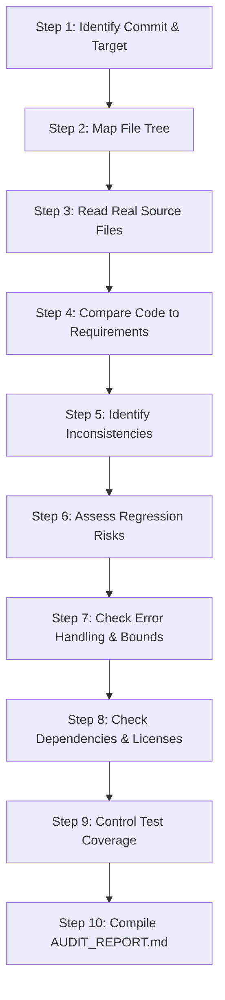

# Code Audit Workflow (`workflows/code-audit.md`)

## 1. Overview
This workflow defines the formal, evidence-based code review protocol used to verify code quality, detect defects, evaluate technical debt, and ensure adherence to requirements before releases or major milestones.

---

## 2. Entry Criteria
- Source code is committed to a target branch or release candidate tag.
- `docs/REQUIREMENTS.md` and `docs/ARCHITECTURE.md` are accessible.

---

## 3. The 10-Step Inspection Protocol

1. **Identify Inspection Target**: Record the exact Git branch, commit hash, and target software version under review.
2. **Examine File Hierarchy**: Review complete repository structure, identifying active modules, deprecated files, and configuration files.
3. **Read Concerned Source Files**: Read the full implementation of all active source files. Never evaluate a file based on summary or name alone.
4. **Compare Code Against Requirements**: Verify that each `REQ-F-xxx` has a real, matching code path. Flag missing or incomplete implementations.
5. **Identify Inconsistencies**: Check for API mismatches, type inconsistencies, dead code, or divergent architectural patterns.
6. **Examine Regression Risks**: Analyze whether recent modifications could compromise previously validated functionality documented in `docs/PROJECT_STATE.md`.
7. **Examine Error Handling & Boundaries**: Inspect boundary conditions: null pointers, off-by-one errors, buffer bounds, timeout handling, and exception recovery.
8. **Examine Dependencies & Configuration**: Check build settings (`platformio.ini`, `CMakeLists.txt`, `package.json`), external library versions, and potential licensing issues.
9. **Control Available Tests**: Check whether tests assert meaningful runtime properties or merely execute without real validation.
10. **Compile Formal Audit Report**: Author `docs/AUDIT_REPORT.md` and log any newly discovered defects into `docs/KNOWN_ISSUES.md`.

---

## 4. Severity Classification Standard
- `CRITICAL`: Severe security vulnerability, memory corruption, system crash/watchdog reset, or complete data loss.
- `HIGH`: Major functional requirement broken, unhandled failure in core path, or regression on validated feature.
- `MEDIUM`: Edge case failure, performance degradation, resource leak under load, or incomplete error reporting.
- `LOW`: Code style divergence, minor documentation omission, non-blocking warning.
- `INFORMATION`: Missing external information, uninspected inaccessible file, or architectural observation.

---

## 5. Exit Criteria & Quality Gate QG-04
- `docs/AUDIT_REPORT.md` completed with executive summary, finding matrix, and detailed finding cards.
- `docs/KNOWN_ISSUES.md` updated with confirmed defects (`ISSUE-xxx`).
- Quality Gate QG-04 evaluated (`PASS` if zero open CRITICAL/HIGH issues; otherwise `FAIL` or `BLOCKED`).
