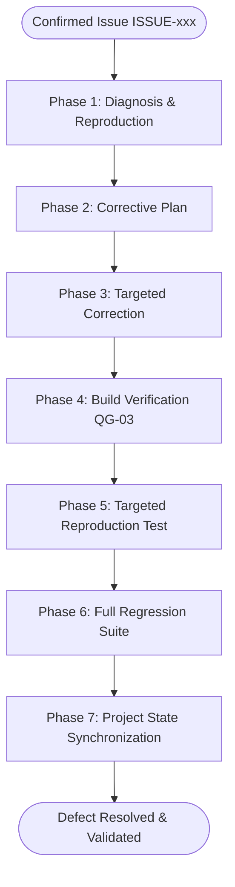

# Corrective Release Workflow (`workflows/corrective-release.md`)

## 1. Overview
This workflow governs the diagnosis, containment, targeted correction, and regression verification of a confirmed defect. It guarantees that bug fixes are laser-focused, fully verified, and do not introduce collateral regressions.

---

## 2. Cardinal Rule of Corrective Releases
> **NO UNREQUESTED FEATURES DURING A BUGFIX.**  
> Never bundle opportunistic enhancements, refactorings, or unrelated changes into a corrective patch. Scope must be strictly limited to the diagnosed defect locus.

---

## 3. Step-by-Step Procedure

### Phase 1: Diagnosis & Reproduction (Skill: `code-auditor` + `test-engineer`)
1. Assign stable issue ID: `ISSUE-xxx` in `docs/KNOWN_ISSUES.md`.
2. Formulate an exact, minimal reproduction procedure.
3. Capture concrete empirical evidence (terminal crash logs, assertion failure, unexpected return code).
4. Identify root cause in source code (file, function, line reference).
5. Specify target regression test: `REG-xxx` in `docs/TEST_PLAN.md` with status `NOT_RUN`.

### Phase 2: Corrective Plan Formulation
1. Author `docs/CORRECTIVE_PLAN.md` detailing:
   - Root cause analysis.
   - Minimal modification locus (files, functions).
   - Side-effect analysis on related modules.
   - Regression prevention plan.

### Phase 3: Targeted Code Correction (Skill: `prompt-generator`)
1. Generate precision corrective prompt (`prompts/generate-corrective-prompt.md`).
2. Strictly forbid modifying unrelated files or introducing new features.
3. Apply code fix.

### Phase 4: Build Verification (Quality Gate QG-03)
1. Verify compilation on all target toolchains.
2. Confirm zero new compiler warnings or linker errors.

### Phase 5: Targeted Defect Verification (Skill: `test-engineer`)
1. Run test `REG-xxx` matching the reproduction scenario.
2. Verify that the previously failing behavior now passes cleanly.
3. Record console log in `docs/TEST_RESULTS.md`.

### Phase 6: Full Regression Verification
1. Re-run all existing unit, integration, and hardware tests (`UNIT-xxx`, `INT-xxx`, `SYS-xxx`, `MAT-xxx`).
2. Verify that zero previously validated features have regressed.

### Phase 7: Project State & Issue Registry Synchronization
1. Update `docs/KNOWN_ISSUES.md`: mark `ISSUE-xxx` as `RESOLVED`, reference commit hash and `REG-xxx`.
2. Update `docs/PROJECT_STATE.md`:
   - Increment patch version (e.g., `0.1.0` -> `0.1.1`).
   - Move issue from Open to Resolved.
   - Document new commit hash and next recommended step.

---

## 4. Exit Criteria
- Reproduction test `REG-xxx` passes with empirical proof.
- Full regression suite shows zero regressions.
- `docs/KNOWN_ISSUES.md` and `docs/PROJECT_STATE.md` fully synchronized.
