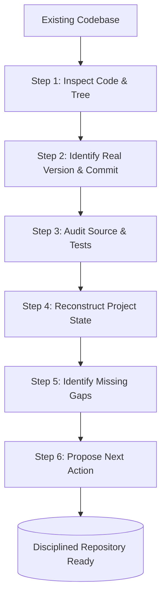

# Existing Project Import Workflow (`workflows/existing-project.md`)

## 1. Overview
This workflow governs the onboarding and state reconstruction of an existing, un-documented, or legacy project into the **CalmTechnology-DevToolkit** framework without altering working code during the import phase.

---

## 2. Cardinal Rule of Project Import
> **DO NOT MODIFY CODE DURING THE IMPORT PHASE.**  
> The sole purpose of this workflow is observation, audit, and reconstruction of truth. No refactoring, no bug fixing, and no feature generation may take place during import.

---

## 3. Step-by-Step Procedure

### Step 1: Inspect Codebase File Tree
- Map the repository structure: directories, source files, header files, build scripts (`platformio.ini`, `CMakeLists.txt`, `package.json`, `pyproject.toml`).
- Check for existing documentation, READMEs, or architecture diagrams.

### Step 2: Identify Real Version and Target Commit
- Read version files, tag histories, or package metadata.
- Record the current Git branch and commit hash in `docs/PROJECT_STATE.md`.
- Note if uncommitted modifications exist in the working tree.

### Step 3: Examine Available Source Code and Tests (Skill: `code-auditor`)
- Read core domain modules, hardware adapters, and entry points.
- Distinguish between claimed features (in `README.md`) and actual implemented code.
- Inspect test directories to see what tests actually exist, what framework they use, and if they pass.

### Step 4: Reconstruct Project Documentation
Using the templates in `templates/`, initialize or populate in `docs/`:
1. `docs/PROJECT.md`: Define current scope, platform targets, and architecture style.
2. `docs/REQUIREMENTS.md`: Reverse-engineer baseline requirements (`REQ-F-xxx`) reflecting currently working features.
3. `docs/ARCHITECTURE.md`: Document module boundaries, data flows, and active dependencies.
4. `docs/DECISIONS.md`: Record known historical architecture choices as ADRs.
5. `docs/KNOWN_ISSUES.md`: Catalog defects and code smells discovered during initial inspection.
6. `docs/TEST_PLAN.md` & `docs/TEST_RESULTS.md`: Catalog existing tests and initialize them with current verified state or `NOT_RUN`.

### Step 5: Identify Missing Information & Blind Spots
- List missing documentation, absent hardware tests, missing error handling, and unverified assumptions.
- Flag any files that could not be read or built.

### Step 6: Formulate `docs/PROJECT_STATE.md` and Recommended Next Action
- Populate `docs/PROJECT_STATE.md` with:
  - Real version and commit.
  - Validated features (features proven to work).
  - Unvalidated features (claimed but unverified).
  - Open issues (`KNOWN_ISSUES.md`).
  - Strict recommendation for the immediate next engineering step (e.g., "Run test campaign", "Implement missing test harness", or "Audit module X").

---

## 4. Exit Criteria
- `docs/PROJECT_STATE.md` accurately describes the current codebase state.
- Zero source code files modified during the import process.
- Team and AI assistant share an identical, verifiable understanding of project reality.
