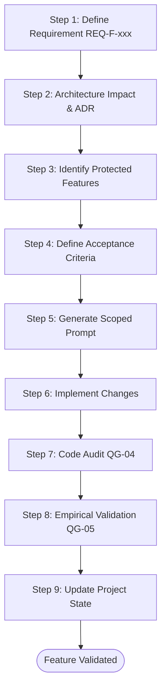

# Feature Development Workflow (`workflows/feature-development.md`)

## 1. Overview
This workflow governs the addition of a new capability or feature to an existing, established project. It guarantees that new features do not destabilize existing validated functionality.

---

## 2. Entry Criteria
- `docs/PROJECT_STATE.md` is current and verified.
- Target project is at a clean Git commit.
- A new functional requirement has been requested by the user.

---

## 3. Step-by-Step Procedure

### Step 1: Define the Requirement (Skill: `project-definition`)
- Formulate requirement with stable ID: `REQ-F-xxx`.
- Define exact user action, system response, priority (P0/P1/P2), and quantifiable acceptance criteria.
- Append requirement to `docs/REQUIREMENTS.md`.

### Step 2: Examine Architecture Impact (Skill: `software-architect`)
- Assess impact on existing modules, data structures, and memory budgets.
- If significant changes are needed, author a new Architecture Decision Record (`ADR-xxx`) in `docs/DECISIONS.md`.
- If embedded: check impact on internal SRAM, PSRAM, and task execution deadlines.

### Step 3: Identify Features to Preserve (Regression Prevention)
- Read `docs/PROJECT_STATE.md` list of **Validated Features**.
- Explicitly identify which existing features share code paths or resources with the new feature.
- Mark these features as **Protected Against Modification**.

### Step 4: Define Acceptance Criteria & Test Cases (Skill: `test-engineer`)
- Author test case specification (`SYS-xxx`, `INT-xxx`, `MAT-xxx`) in `docs/TEST_PLAN.md` with status `NOT_RUN`.

### Step 5: Generate Scoped Development Prompt (Skill: `prompt-generator`)
- Use `prompts/generate-development-prompt.md` to produce a strictly bounded prompt.
- Explicitly declare allowed files for modification and forbidden files.
- Inject the requirement ID, acceptance criteria, and protected features list.

### Step 6: Implement Feature
- Execute code modifications within defined boundaries.
- Verify compilation on target toolchains (Quality Gate QG-03).

### Step 7: Audit Implementation (Skill: `code-auditor`)
- Audit modified files against `REQ-F-xxx` and architecture specifications.
- Verify that protected features have not been altered without justification.
- Ensure Quality Gate QG-04 passes.

### Step 8: Execute Test Suite (Skill: `test-engineer`)
- Run targeted test for new feature.
- Run regression tests for all protected features.
- Record console logs and statuses in `docs/TEST_RESULTS.md`.

### Step 9: Update Documentation and Project State
- Update `docs/REQUIREMENTS.md` with requirement status `VALIDATED`.
- Update `docs/PROJECT_STATE.md`: add feature to **Validated Features**, increment commit reference, set next action.

---

## 4. Exit Criteria
- New feature validated with empirical test evidence in `docs/TEST_RESULTS.md`.
- Zero regressions observed on existing validated features.
- `docs/PROJECT_STATE.md` updated and synchronized.
