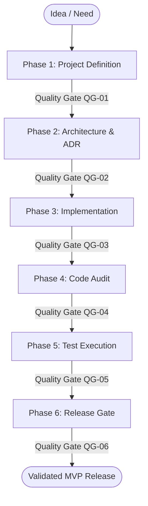

# New Project Workflow (`workflows/new-project.md`)

## 1. Overview
This workflow governs the creation of a new software or embedded system project from the initial idea through requirements, architecture, initial implementation, verification, and first release evaluation.

---

## 2. Entry Criteria
- A user concept, business objective, or problem statement is formulated.
- Target deployment platform is identified (e.g., M5Stack CoreS3, Web, Electron).

---

## 3. Workflow Phases

### Phase 1: Project Definition (Skill: `project-definition`)
1. Create project documentation root (`docs/`).
2. Populate `docs/PROJECT.md` using `templates/PROJECT.md`.
3. Formulate functional requirements (`REQ-F-xxx`) and non-functional requirements (`REQ-NF-xxx`) in `docs/REQUIREMENTS.md`.
4. Establish explicit acceptance criteria and out-of-scope capabilities.
5. Initialize `docs/PROJECT_STATE.md` with phase `DEFINITION`.
6. **Evaluate Quality Gate QG-01 (Definition Ready)**:
   - Status: `PASS` when requirements are unambiguous, testable, and prioritized.

### Phase 2: Architecture & System Design (Skill: `software-architect` + `embedded-engineer`)
1. Review target technical profiles (`profiles/cores3.md`, `profiles/esp32.md`, etc.).
2. Decompose system into components and define data flows in `docs/ARCHITECTURE.md`.
3. Record significant design decisions as ADRs (`ADR-001`, `ADR-002`) in `docs/DECISIONS.md`.
4. If embedded target: establish memory budget (internal SRAM, PSRAM, Flash) and FreeRTOS task map.
5. Define test cases in `docs/TEST_PLAN.md` with status `NOT_RUN`.
6. **Evaluate Quality Gate QG-02 (Architecture Ready)**:
   - Status: `PASS` when interfaces and ADRs are documented.

### Phase 3: Bounded Implementation (Skill: `prompt-generator`)
1. Generate scoped development prompts (`prompts/generate-development-prompt.md`).
2. AI assistant or developer implements components within specified file boundaries.
3. Verify static compilation on target toolchain (e.g., PlatformIO build, GCC build, TypeScript compiler).
4. **Evaluate Quality Gate QG-03 (Build Ready)**:
   - Status: `PASS` when code compiles cleanly with zero critical warnings.

### Phase 4: Code Audit (Skill: `code-auditor`)
1. Audit actual committed source code following the 10-step protocol.
2. Compile `docs/AUDIT_REPORT.md` and log any anomalies in `docs/KNOWN_ISSUES.md`.
3. **Evaluate Quality Gate QG-04 (Audit Ready)**:
   - Status: `PASS` when zero CRITICAL or HIGH severity issues are open.

### Phase 5: Empirical Validation (Skill: `test-engineer`)
1. Execute unit and integration tests (`UNIT-xxx`, `INT-xxx`, `SYS-xxx`).
2. If embedded: execute hardware tests on physical board (`MAT-xxx`).
3. Record verified results and console logs in `docs/TEST_RESULTS.md`.
4. Update `docs/PROJECT_STATE.md` with validated features.
5. **Evaluate Quality Gate QG-05 (Validation Ready)**:
   - Status: `PASS` when all P0 requirements pass test suites.

### Phase 6: Release Gate Review (Skill: `release-reviewer`)
1. Complete `docs/RELEASE_CHECKLIST.md`.
2. Generate formal `docs/RELEASE_REPORT.md` with decision (`GO`, `CONDITIONAL_GO`, `NO_GO`, `INSUFFICIENT_EVIDENCE`).
3. **Evaluate Quality Gate QG-06 (Release Ready)**:
   - Final release authorization delivered to developer.

---

## 4. Exit Criteria
- `docs/PROJECT_STATE.md` reflects current status with all validated features listed.
- Quality Gates QG-01 through QG-06 evaluated with empirical evidence.
- Project is ready for version tagging by human developer.
