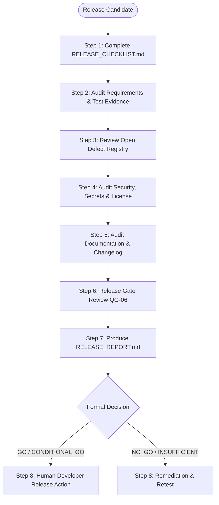

# Public Release Workflow (`workflows/public-release.md`)

## 1. Overview
This workflow defines the formal release evaluation procedure required before any software version is tagged, packaged, or made publicly available. It enforces the Quality Gate QG-06 review and guarantees that releases are published with complete transparency regarding verified capabilities, remaining defects, and operational limits.

---

## 2. Cardinal Rules of Release Publishing
1. **Zero Autonomous Publishing**: The AI assistant never runs `git push --tags`, publishes npm/pypi packages, or uploads release binaries autonomously. The assistant evaluates evidence and produces the release report; the human developer authorizes and performs the physical release.
2. **Strict Hardware Evidence Rule**: On embedded projects, a public release cannot receive a definitive `GO` if hardware tests (`MAT-xxx`) are `NOT_RUN`. If only simulation has been executed, the decision is strictly `INSUFFICIENT_EVIDENCE` or `CONDITIONAL_GO` (labeled as "Host Simulation Preview").
3. **No Hidden Defects**: Every known issue, workaround, and platform limitation must be clearly documented in the release notes.

---

## 3. Step-by-Step Procedure

### Step 1: Complete Release Checklist (Skill: `release-reviewer`)
- Populate `docs/RELEASE_CHECKLIST.md` verifying all verification gates (QG-01 through QG-05).

### Step 2: Audit Requirements & Empirical Test Evidence
- Verify that 100% of P0 functional requirements are validated in `docs/TEST_RESULTS.md`.
- Confirm that all executed tests have attached empirical logs and timestamps.

### Step 3: Review Defect Registry (`docs/KNOWN_ISSUES.md`)
- Verify that **ZERO** `CRITICAL` or `HIGH` severity defects are open.
- Verify that any open `MEDIUM` or `LOW` defects have documented workarounds.

### Step 4: Audit Security, Secrets, and Licensing
- Confirm presence of valid `LICENSE` (MIT).
- Perform search for leaked secrets, tokens, API keys, private passwords, or absolute local paths.

### Step 5: Audit Documentation, Versioning, and Changelog
- Verify version consistency in `VERSION`, `CHANGELOG.md`, and build files.
- Verify that `README.md` and `README.fr.md` accurately describe the release.

### Step 6: Formulate Formal Release Decision
Evaluate against the four standard verdicts:
- **`GO`**: All requirements verified, all mandatory tests pass, zero critical/high issues, docs complete, hardware verified.
- **`CONDITIONAL_GO`**: Minor non-critical limitations exist, documented in release notes with accepted residual risk.
- **`NO_GO`**: Unresolved critical/high defects, failing core tests, security vulnerability, or unhandled regression.
- **`INSUFFICIENT_EVIDENCE`**: Mandatory tests (such as physical hardware validation) remain `NOT_RUN`.

### Step 7: Produce Release Report (`docs/RELEASE_REPORT.md`)
- Author formal evaluation report including:
  - Executive summary and formal verdict.
  - Test evidence summary table.
  - Known issues and disclosed limitations.
  - Release notes text ready for public posting.

### Step 8: Human Developer Sign-Off
- Present `docs/RELEASE_REPORT.md` to the user for final decision and manual release tagging.

---

## 4. Exit Criteria
- `docs/RELEASE_CHECKLIST.md` fully checked.
- `docs/RELEASE_REPORT.md` generated with definitive verdict.
- Quality Gate QG-06 evaluated.
