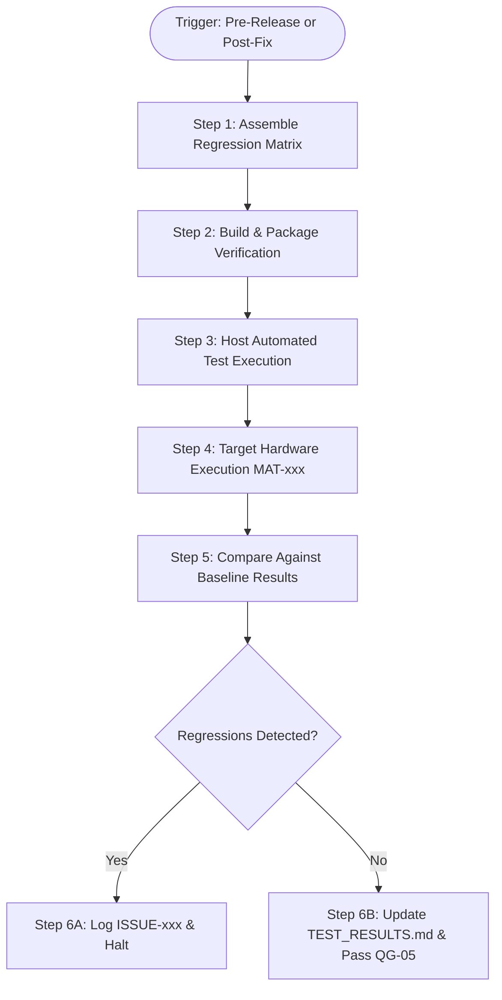

# Regression Testing Workflow (`workflows/regression-testing.md`)

## 1. Overview
This workflow defines the systematic non-regression test protocol. It is executed before any release candidate sign-off, after major refactoring, or following a corrective bug fix, ensuring that the system's baseline validated capabilities remain intact.

---

## 2. Entry Criteria
- Source code is buildable with zero errors.
- `docs/PROJECT_STATE.md` lists validated features and associated tests.
- `docs/TEST_PLAN.md` contains historical test specifications.

---

## 3. Step-by-Step Procedure

### Step 1: Assemble the Regression Matrix (Skill: `test-engineer`)
1. Extract all previously passing tests from `docs/TEST_RESULTS.md`:
   - Unit tests (`UNIT-xxx`).
   - Integration & system tests (`INT-xxx`, `SYS-xxx`).
   - Historical defect regression tests (`REG-xxx`).
   - Target hardware acceptance tests (`MAT-xxx`).
2. Mark all tests in the current run queue as `NOT_RUN`.

### Step 2: Build & Clean Environment Verification
1. Perform clean build from scratch (delete build caches, `.pio`, `build/`).
2. Verify zero warnings treated as errors.

### Step 3: Execute Host Test Suite
1. Run automated test runner (e.g., `ctest`, `pytest`, `npm test`).
2. Capture full terminal logs, test counts, and execution durations.

### Step 4: Execute Target Hardware Acceptance Tests (If Embedded Target)
1. Flash target binary to physical board (e.g., M5Stack CoreS3).
2. Execute physical interaction scenarios (display rotation, touch responsiveness, audio output, serial commands).
3. If hardware is unavailable, explicitly document: `HARDWARE TESTS NOT_RUN (Target hardware unavailable)`. Never assume pass.

### Step 5: Compare Against Baseline Results
1. Check each executed test against its historical expected result.
2. Identify any test that previously passed and now fails or exhibits degraded performance.

### Step 6: Evaluate Results & Update Records
- **If regression detected**:
  1. Immediately log new defect `ISSUE-xxx` in `docs/KNOWN_ISSUES.md`.
  2. Mark Quality Gate QG-05 as `FAIL`.
  3. Transition to `workflows/corrective-release.md`.
- **If all tests pass**:
  1. Record timestamped console logs in `docs/TEST_RESULTS.md`.
  2. Update `docs/PROJECT_STATE.md`.
  3. Mark Quality Gate QG-05 as `PASS`.

---

## 4. Exit Criteria
- Complete regression suite executed.
- Verified absence of regressions documented with empirical evidence in `docs/TEST_RESULTS.md`.
- Quality Gate QG-05 sign-off achieved.
